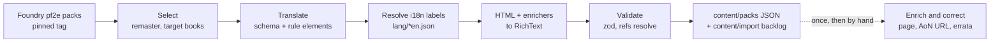

# Content model

Content is everything the rules define: traits, statistics, conditions, actions, ancestries, heritages,
backgrounds, classes and their features, feats, spells, equipment, runes, deities, languages, creatures. It is data
in the database, never code.

## Content entry

Every entry, of every kind, shares one envelope. Kind-specific data hangs off it with its own zod schema.

```ts
interface ContentEntry<K extends ContentKind> {
  id: ContentId; // UUIDv5 of `<pack>/<slug>`
  pack: PackId;
  kind: K;
  slug: EntrySlug; // `<kind>:<name>` (`ancestry:human`), permanent once published (ADR-0034)
  name: string;
  level?: number; // 0 to 30; a creature always has one, from -1 to 25
  rarity: 'common' | 'uncommon' | 'rare' | 'unique';
  traits: readonly TraitSlug[];
  sources: readonly SourceRef[]; // at least one, see below
  description: RichText; // ORC rules text for official content, author text for homebrew
  rules: readonly RuleElement[];
  display?: DisplayHints; // e.g. feat display category override, see play-and-campaigns.md
  externalIds?: { foundry?: string; aon?: AonUrl; pathbuilder?: string };
  supersedes?: readonly ContentId[]; // remaster entry replacing a legacy one
  data: KindData[K];
}
```

`ContentEntry` in `libs/rules/sdk` (`content-entry.ts`) is this envelope as a zod schema. `kind` picks the `data`
schema from a kind registry (`KIND_DATA`, `kind-data.ts`); a kind with no schema yet is an error naming it. On top
of the field schemas it checks that `id` is UUIDv5 of `<pack>/<slug>`, that the slug names the entry's `kind`,
that there is at least one source, that traits are unique, and that `supersedes` never holds the entry's own id.
The rules playground's "Content entry" mode loads an example per registered kind. Packs are stored as entries (see
"Packs and storage"); until the registry serves entries directly, `contentPackFromFiles` (`content-pack-file.ts`)
turns them into the definitions it holds today and wraps each in `PackEntry`.

### Kinds

| Group      | Kinds                                                                                                            |
| ---------- | ---------------------------------------------------------------------------------------------------------------- |
| Rules core | `statistic`, `trait`, `condition`, `action`, `damage-type`, `sense`, `language`, `variant-rule`                  |
| Build      | `ancestry`, `ancestry-feature`, `heritage`, `background`, `class`, `class-feature`, `feat`, `archetype`, `deity` |
| Magic      | `spell` (incl. focus spells and cantrips), `ritual`, `spellcasting-tradition`                                    |
| Equipment  | `weapon`, `armor`, `shield`, `equipment`, `consumable`, `rune`, `treasure`, `kit`                                |
| Play       | `effect` (spell and feat effects, GM effects)                                                                    |
| Bestiary   | `creature`, `hazard` (later milestone)                                                                           |

Class progression (features by level, feat slots, skill increases, boosts) is data on the `class` entry, expressed
as `GrantItem` and slot-granting rule elements keyed by level, and its skill increase levels. The builder's feat and
subclass slots fall out of the engine; its boost and skill slots are the character domain's, with Player Core's default
increase schedule and rank caps by level in code ([ADR-0038](../adr/0038-skill-slots-come-from-class-data.md)).

Statistics are content too: a `statistic` entry names a selector, its domains, an actor-only base formula, and
whether it is a check or a DC (see [rules-engine.md](rules-engine.md#statistics-are-content)).

#### Rules core data

Each kind's `data` follows what Foundry pf2e stores for it, in Pioneer's words. What an entry does to statistics is
in its `rules`, not repeated in `data`; a condition's `implies` is the one exception, below. Schemas live in
`libs/rules/sdk`, registered in `kind-data.ts`.

| Kind           | `data`                                                                                                                                            |
| -------------- | ------------------------------------------------------------------------------------------------------------------------------------------------- |
| `condition`    | `valued`; `group?`, Foundry's sheet grouping, which says nothing about stacking; `overrides`; `implies`                                           |
| `action`       | `cost?`; `upTo?`; `skills?`; `category?`; `requirements?` and `trigger?` as rich text; `triggerEvent?`; `autoApply?`; `frequency?`; `selfEffect?` |
| `damage-type`  | none yet; a type's group stays in `DAMAGE_GROUP_TYPES`, as Foundry keeps it in code                                                               |
| `sense`        | `acuity?`, the acuity the sense always has; `unlimitedRange?` (darkvision)                                                                        |
| `trait`        | `appliesTo`: each kind that carries it once, from the Foundry trait list it sits in                                                               |
| `language`     | none yet; rarity is the envelope's                                                                                                                |
| `variant-rule` | none yet; what it changes is in `rules`, applied to every character in a campaign that enables it                                                 |

- `condition`: `valued` says whether it takes a value (Frightened 2) or not (Blinded). `group` is one of
  `abilities`, `attitudes`, `death`, `detection`, `senses`. `overrides` lists the conditions it replaces
  (Blinded overrides Dazzled), and is how conditions exclude each other. `overrides` and `implies` are `ContentId[]`.
- `action`: `cost` is an `action-cost` glyph, absent for a passive ability. `upTo` makes the cost variable, the user
  picking how many: a count above a `one`, `two` or `three` cost, at most six, as an activity can span two turns.
  `skills` are the skills it uses, by selector (`skill:athletics`). `frequency` is `max` uses `per` turn, round,
  minute, ten minutes, hour, 24 hours, day, week, month or year. `selfEffect` is the effect it applies to
  the user, by `ContentId`. `triggerEvent` and `autoApply` are below.
- **Trigger events.** An action or effect that fires on an event has a `triggerEvent`: an `event` (`initiative`,
  `turn-start`, `turn-end`, `cast-spell`, `strike`, `damage-taken`), each from the point of view of the character it
  belongs to, and an optional `predicate` over the event's roll options. The spell cast or the weapon used is the
  event's `item`, as in Foundry, so "you cast a focus spell" is `cast-spell` with `item:trait:focus`. The rich text
  `trigger` stays the wording shown. `autoApply: false` makes a free, beneficial ability prompt rather than apply at
  once, and needs a `triggerEvent` (play-and-campaigns.md, "Triggered abilities"). A feat or class feature that is an
  action carries both on its `action`.

Two checks span fields: a reaction needs a `trigger`, and every condition in `implies` needs a `GrantItem` of it in
`rules` with no predicate. Foundry applies implied conditions (Grabbed's Off-Guard and Immobilized) with
`GrantItem`, and so does the engine; `implies` is the list the sheet shows. The check runs one way: a condition may
grant more than it lists.

#### Build data

The same rule holds for build kinds: `data` is what Foundry pf2e stores, less what rule elements already express.
Lists of attributes, slugs and ids name each item once.

| Kind               | `data`                                                                                                                                                      |
| ------------------ | ----------------------------------------------------------------------------------------------------------------------------------------------------------- |
| `ancestry`         | `hitPoints`, `size`, `speed`, `reach`; `boosts`; `flaws`; `languages`; `additionalLanguages`; `vision?`                                                     |
| `ancestry-feature` | `action?`; granted by its ancestry or heritage, never picked                                                                                                |
| `heritage`         | `ancestry?`, absent for a versatile heritage                                                                                                                |
| `background`       | `boosts`; trained skills and lore are `Proficiency` elements, its skill feat a `GrantItem`                                                                  |
| `class`            | `keyAttribute`, the attributes it may be; `hitPoints` per level; `additionalSkills`; `skillIncreaseLevels?`; progression in `rules`                         |
| `class-feature`    | `action?`; `tags?`; `keyAttributeOptions?`; always has a `level`                                                                                            |
| `feat`             | `category`; `prerequisites?` as rich text; `prerequisitePredicate?`; `onlyLevel1?`; `maxTakable?`; `action?`; `skills?`; `archetype?`; always has a `level` |
| `archetype`        | `dedication`; `multiclass?`, the class it is the multiclass archetype of                                                                                    |
| `deity`            | `category`; `sanctification?`; `domains`; `font`; `attributes`; `skills`; `weapons`; `spells`                                                               |

- **Boosts.** A boost is the attributes it may go to: one for a fixed boost, all six for a free one. An ancestry
  lists up to four, a background two (Farmhand: Constitution or Wisdom, then free). `flaws` are fixed attributes.
- **Languages.** `languages` and `additionalLanguages.options` are `language` entries by `ContentId`;
  `additionalLanguages.count` is the number picked beyond those granted, before the Intelligence modifier.
  A feat, heritage or class feature teaches languages with `Language` elements, which the character model reads
  (character-model.md, "Languages").
  `vision` is the `sense` entry an ancestry sees with (darkvision, low-light vision), absent for ordinary vision.
- **Ancestry features.** Keen Eyes, Plant Nourishment and the like are their own kind, `ancestry-feature`, as class
  features are, rather than a feat category: an ancestry feat slot queries feats by the ancestry's trait, which its
  features carry too, so as feats they would be offered there. An ancestry or heritage grants each by `GrantItem` in
  its `rules`, and its roll option is `feature:<slug>`, as in Foundry.
- **Key attribute options.** A class feature's `keyAttributeOptions` widen its class's `keyAttribute` while the
  character has it at 1st level: a rogue keys off Dexterity, or Strength once Ruffian is its racket (Mastermind
  Intelligence, Scoundrel Charisma). A key attribute picked that the class no longer offers is kept, invalid.
- **Class progression.** Perception, save, attack, defence, skill and class DC ranks are `Proficiency` elements,
  later ranks behind a level predicate (`{ "gte": ["self:level", 7] }`). Each class feature is a `GrantItem`, and
  each feat slot a `ChoiceSet` querying feats (`["item:trait:fighter", { "lte": ["item:level", "self:level"] }]`)
  behind the level it opens at. Foundry's `classFeatLevels` and the other feat level lists have no field here; its
  `skillIncreaseLevels` is the one kept (Player Core's 3rd and every second level when absent; a rogue's every level
  from 2nd), as the builder opens skill increase slots itself (character-model.md, "Skills"). The
  subclass (a doctrine, muse, order or school) is a class feature's `ChoiceSet` querying class features by tag
  (`["item:tag:cleric-doctrine"]`), with the `GrantItem` of its pick; a class feature's `tags` are its roll options
  `tag:<tag>`, and the class's `subclass` names the tag its subclass options carry, since a class may have more than
  one such query (a wizard's arcane school and thesis) ([ADR-0036](../adr/0036-class-names-its-subclass-by-tag.md)).
- **Feats.** `category` is Foundry's: `ancestry`, `class`, `general`, `skill` or `bonus`; an archetype feat is a
  class feat with the `archetype` trait. `maxTakable` is a count or `unlimited` (Foundry's `null`), once when
  absent. A feat with `onlyLevel1` must be level 1. `action` is an `action` kind's `data`, for a feat or class
  feature used as an action. `skills` are the skills a feat is about (Assurance); `archetype` is the `archetype`
  entry an archetype feat belongs to, by `ContentId`. The sheet placement override is the envelope's `display`.
  Foundry's feature categories on the same item type go elsewhere:
  `classfeature` is the `class-feature` kind, `ancestryfeature` the `ancestry-feature` kind, and `calling`, `curse`,
  `deityboon` and `pfsboon` have no kind yet, so the importer reports them.
- **Prerequisites.** `prerequisites` keeps Foundry's text and gains `prerequisitePredicate?`, which the prerequisite
  pass derives where it can parse the text ("trained in Medicine", "Champion Dedication", "Strength +2"; Foundry
  import, Prerequisite enrichment). A feat with no predicate is offered as unknown under three-valued predicates
  (ADR-0002): shown with its text, never hidden, never treated as met. The coverage report lists the unparsed
  prerequisites.
- **Archetypes.** Foundry keeps them as journal pages; the importer builds the entry from the page and its
  dedication feat (Foundry import, Archetypes).
  `dedicationLock?` is how many other archetype feats a character needs before another dedication (2 when
  absent; character-model.md, Archetype dedications).
- **Deities.** `category` is `deity`, `pantheon`, `covenant` or `philosophy`. `sanctification` is `can` or `must`
  with `holy` and/or `unholy`. `domains` has `primary` and `alternate` domains, each one of Foundry's config keys
  (`DeityDomain`, apocryphal variants included; the import files Disorientation under `delirium`, Nothingness under
  `void` and Dragon under `wyrmkin`, as Foundry keys them). `font` is `harm` and/or `heal`, `skills` are statistic
  selectors, `weapons` base weapon slugs (a weapon's `baseItem`), and `spells` one spell per rank from 1 to 10. A
  philosophy has no font, domains or spells, and divine skills must be `skill:` selectors. A deity on a character
  sets `deity:primary:<slug>`, and under `deity:primary` its sanctification, favoured weapons and fonts, as Foundry
  does (ADR-0046), and its divine skills (`deity:primary:skill:medicine`, ADR-0048).

#### Magic and play data

Foundry pf2e stores a spell's range, targets, casting time and duration as free text; Pioneer stores them as
structures, and the importer reports a spell whose text doesn't map
([ADR-0021](../adr/0021-structured-spell-casting-fields.md)). Rule elements on a spell are rare: what it does beyond
its damage is its description, and the effects it applies are `effect` entries.

| Kind                     | `data`                                                                                                                                                         |
| ------------------------ | -------------------------------------------------------------------------------------------------------------------------------------------------------------- |
| `spell`                  | casting fields; `traditions`; `damage`; `heightening?`; `counteraction?`                                                                                       |
| `ritual`                 | casting fields; `primary` check; `secondary` checks and `casters`                                                                                              |
| `spellcasting-tradition` | `skill`, the skill that recalls and identifies its magic (`skill:arcana`)                                                                                      |
| `effect`                 | `category`, `spell`, `feat`, `equipment` or `other` (a GM's); `duration`; `badge?`; `triggerEvent?` and `autoApply?`, as on an action; level is the envelope's |

- **Casting fields.** `rank` 1 to 10. `time` is `actions` with a glyph `cost`, and `upTo` for a range ("one to
  three actions", Heal), or `time` with a `count` of rounds to years ("3 days"). `range?` is feet, `touch`,
  `planetary` or `unlimited`. `area?` is a `shape` and `size`, with a `width` on a line. `targets?` lists the
  alternatives in `any` ("1 willing living creature or 1 undead"), and in `plus` targets taken as well ("1 ally and
  1 enemy"). Each has a `count`: a number (`upTo` for "up to"), `any` ("any number of creatures") or `all` with
  where they are, `within` the `area` or `range` ("enemies in the area"); `triggering` for "the triggering
  creature"; what it is (`creature`, `object`, `ally`, `enemy`, `corpse`, `weapon`, `item`, `spell-effect`, or the
  caster's `companion`, `animal-companion`, `familiar`, `eidolon`); `qualifiers` (`willing`, `living`, `dead`,
  `dying`, `sleeping`, `falling`, `flying`, `corporeal`, `unattended`, `magical`) and `traits` ("1 extraplanar
  creature", "1 animal"). `you` is `and` for "you and up to 4 allies", `or` for "you or 1 ally". `duration?` is a
  `time` (with `sustained` for "sustained up to 1 minute"), `sustained`, `until` the end of this turn, the start
  or end of the next (the caster's, or the target's `of: target`) or the next daily preparations, or `unlimited`;
  an instant spell has none. `defense?` is a `save` (a `save:` selector and `basic`), the passive defence it is
  `against` (`ac` or a `save:` selector for that save's DC, Foundry's `passive`), or both; a spell attack is marked
  by the `attack` trait, as in Foundry. `cost?` and `requirements?` are rich text.
- **Spells.** Cantrips and focus spells are spells with the `cantrip` or `focus` trait, as in Foundry. `traditions`
  are `arcane`, `divine`, `occult`, `primal`. `damage` parts each have a `key` (Foundry's record key), a damage
  formula, a `damageType`, an optional `category` and `kinds` (`damage`, `healing` or both). `heightening` is an
  `interval` (every so many ranks, add a formula to named damage parts and feet to the area) or `fixed` (at each
  listed rank above the spell's, replace at least one of damage, range, area, targets or duration). Foundry's
  overlays (Heal's action variants) and spellcasting-entry `location` have no field yet.
- **Rituals.** Foundry stores a ritual as a spell with ritual data. A check is one of its `skills` (`skill:`
  selectors), at a `proficiency` when it names one; each secondary check is its own.
- **Effects.** `duration` is a `time` of rounds to days with an `expiry` (`turn-start`, `turn-end`,
  `round-end`) and `sustained`, `encounter` or `unlimited`. `badge` is a `counter` starting at `value` between
  `min` and `max`, with `labels` and `loop`, or a rolled `formula` that may `reevaluate` at initiative or a turn's
  start or end. Foundry's `tokenIcon`, `unidentified` and the context of the action that applied it are play
  state, not content.

#### Equipment data

Every item kind but `kit` always has a `level`, 0 to 30, and has the physical fields beside those listed. Foundry
pf2e's `ammo` items are consumables with the `ammunition` category, and its `backpack` items are equipment with a
`container` ([ADR-0023](../adr/0023-equipment-kinds-diverge-from-foundry-items.md)). Whether an item is equipped,
invested or identified is play state, not content.

| Kind         | `data`                                                                                    |
| ------------ | ----------------------------------------------------------------------------------------- |
| `weapon`     | `category`; `damage`; `usage`; `group?`; `baseItem?`; bomb and ranged fields; `runes?`    |
| `armor`      | `category`; `acBonus`; `group?`; `baseItem?`; `dexCap?`; penalties; `strength?`; `runes?` |
| `shield`     | `acBonus`; `hardness` and `hitPoints`, required; `baseItem?`; `speedPenalty?`; `runes?`   |
| `equipment`  | `usage?`; `container?`; `apex?`                                                           |
| `consumable` | `category`; `uses?`; `damage?`; `spell?`; `ammunition?`; `usage?`                         |
| `rune`       | `type`, `fundamental` (with `rune` and `grade`) or `property`; `etchedOnto`               |
| `treasure`   | `category?`: `art-object`, `coin`, `gem` or `material`                                    |
| `kit`        | `price?`; `items`; no physical fields                                                     |

- **Physical fields.** `price?` is `coins` (`pp`, `gp`, `sp`, `cp`, at least one) for `per` items when sold in a
  batch; an item with no price has none. `bulk` is `negligible`, `light` or a whole number, for `bulkPer` items
  when not one (10 arrows are light, 1,000 coins are 1 Bulk). `size?` is medium when absent; `hardness?`,
  `hitPoints?` and `material?` (a precious material slug and its `grade`) complete them.
- **Usage.** Foundry's `usage` string split into parts: `held` in `one`, `one-plus` or `two` hands; `worn`, with a
  `slot` slug (`cloak`, `backpack`) or none; `affixed`, `attached`, `applied` or `installed` `to` a slug
  (`armor-or-a-weapon`); or `tattooed`, `implanted`, `carried` or `other`. Armour and shields have none.
- **Weapons.** `category` is `unarmed`, `simple`, `martial` or `advanced`; `group` one of the remaster groups;
  `baseItem` the base weapon slug, which a deity's favoured `weapons` also name. `damage` is `dice`, a `die` (`d4`
  to `d12`) and a `damageType`, with `persistent` damage as a formula and type (bombs); with no `die`, `dice` is flat
  damage (a blowgun's 1), and 0 is none (a glue bomb). `range` is the range increment, `reload` the actions to
  reload, and `ammunition` the `type` it fires, or `builtIn`, with its `capacity`: the ranged fields. With no `type`
  and not built in, it fires any ammunition that isn't a magazine. Traits carry the rest (`versatile-p`,
  `thrown-20`). Alchemical bombs are weapons, as in Foundry; `splash` and `itemBonus` are their splash damage and
  attack bonus.
- **Armour and shields.** Armour `category` adds `light-barding` and `heavy-barding` to the proficiency categories.
  Penalties are their size: `checkPenalty` 1 is -1, `speedPenalty` 5 is -5 feet, where Foundry stores them
  negated. `strength` is the Strength modifier at which the penalties go away. A shield that is also a weapon says
  so with its `integrated-…` trait, and a specific one lists that weapon's `integratedRunes`.
- **Runes on specific items.** A specific magic weapon or armour has the `runes` it comes with: `potency` and
  `striking` or `resilient` grades 1 to 4, and `property` runes as `rune` entries, up to five. A potency
  rune's grade limits the runes etched later, not a specific item's, which may come with a property rune and no
  potency rune (a returning starknife).
  A specific shield has a `reinforcing` grade 1 to 6.
- **Runes.** Foundry stores a rune as equipment with an `etched-onto-…` usage and keeps what property runes do in
  code; here a rune is its own kind, and what a property rune does is its `rules`. A `fundamental` rune is
  `potency` (weapon or armour, separate entries), `striking` (weapon), `resilient` (armour) or `reinforcing`
  (shield), at a `grade` up to 4, or 6 for reinforcing. `etchedOnto` is the `item` (`weapon`, `armor`, `shield`)
  and a `restriction` slug from Foundry's usage (`melee`, `metal`).
- **Consumables.** `category` is Foundry's (`potion`, `scroll`, `wand`, `talisman`…) plus `ammunition`. `uses` is
  how many times it is used before it is spent, once when absent; a `kept` one stays when spent (a wand, cast once a
  day). `damage` is a formula, type and `kind`
  (`damage` or `healing`). `spell` is the spell a scroll or wand holds, by `ContentId`, and the `rank` it casts it
  at. Only ammunition has `ammunition`, the kinds it can be fired as (`arrows`, `bolts`), or a magazine's one
  kind; ammunition that names none fits any weapon that doesn't take a magazine.
- **Equipment.** `container` is its `capacity` in Bulk (no limit when absent), how much of what it holds is `ignored`
  however it is carried (a backpack's first 2), and its `heldBulk` when held or stowed differs from its `bulk` worn
  (a backpack is negligible worn, light carried).
  `apex` is the attribute an apex item raises.
- **Kits.** `items` are `ContentId`s with a `quantity`, and a container in a kit lists its `contents` the same
  way. A kit has no level or Bulk; a class kit carries its class's trait.

### Rich text

Descriptions are stored as a small, safe document AST, not HTML: `RichText` in `libs/rules/sdk` (`rich-text.ts`),
see [ADR-0019](../adr/0019-rich-text-ast-rendered-in-rules-ui.md). A document is an array of blocks:

| Block       | Fields                                                                       |
| ----------- | ---------------------------------------------------------------------------- |
| `paragraph` | `content`: inline nodes                                                      |
| `heading`   | `level` 1 to 3, below the heading the text sits under; `content`             |
| `list`      | `ordered`; `items`, each a run of blocks, so items hold paragraphs and lists |
| `table`     | `caption?`, `header?` (one row of cells), `rows`; a cell is inline nodes     |
| `rule`      | a thematic break, as before a spell's heightened entries                     |

Inline nodes carry semantics so text stays live:

- `text`: a run of text, with `marks` `emphasis` and `strong`. Always text, never markup.
- `line-break`: a break inside a run, where the division is content (a stat line, a table cell).
- `ref`: a link to another content entry by `ContentId` ("[Off-Guard]", "[Seek]"), with an optional `label`; the
  name comes from the entry otherwise.
- `check`: a `statistic` selector, an optional `dc` (a number, or `{ against: <selector> }` for another
  statistic's DC such as a class DC), `basic` (saves only) and roll `options` ("DC 20 Athletics", "basic Reflex
  save").
- `damage`: `instances`, each a `formula` of dice and a formula (`2d6`, `1d8 + @attr.str`, `(@item.level)d6`) with an
  optional `damageType` and `persistent` or `splash` `category`; `healing` when it restores hit points ("2d6 fire
  and 1d6 persistent fire", "2d8 healing"). Everything but the dice is checked against the formula vocabulary.
- `template`: an area `shape` and `size` in feet, and a `width` for lines ("60-foot line, 10 feet wide").
- `duration`: a `count` of rounds, minutes, hours or days.
- `action-cost`: an action glyph (`one`, `two`, `three`, `free`, `reaction`), read out as its name.

Checks and damage become rollable with the dice work. A document may nest at most 24 levels of JSON and hold at most
5000 arrays and objects; anything bigger is rejected before the schema walks it.

`libs/rules/ui` renders it: `pio-rich-text` builds every node from frontier components and never sets HTML. Pages
give it names and links for references and statistics with `provideRichTextLinks`, and the outline level of its
headings with `headingLevel`. The rules playground's "Rich text" mode validates a document and previews it.

The importer converts Foundry's HTML and enrichers (`@UUID[...]`, `@Check[...]`, `@Damage[...]`, `@Template[...]`)
into this AST.

## Books and source references

Sources are first-class. `libs/rules/catalog/src/books.json` is the registry, validated on load by `BookRegistry`
(`Book` and `Books` schemas in `libs/rules/sdk`):

```ts
interface Book {
  id: BookId; // 'player-core', 'gm-core', 'monster-core'
  publisher: 'paizo';
  license: 'ORC' | 'Paizo-CUP' | 'homebrew'; // ContentLicense, shared with pack manifests
  remaster: boolean;
  released?: PlainDate;
  aonSourceUrl?: Url; // the book's AoN Sources page
}

// Titles are not stored: BOOK_TITLES maps each BookId to a message key, and the registry rejects a
// book without one (ADR-0024). Published books only: homebrew cites a `homebrew` source, and OGL
// joins ContentLicense when a legacy book is imported.

type SourceRef =
  | { kind: 'book'; book: BookId; page?: number; aon?: Url }
  | { kind: 'web'; url: Url; title?: string }
  | { kind: 'homebrew'; author: UserId; pack: PackId; url?: Url };
```

Validation: every entry needs at least one source. A `book` source may cite the book alone until its page and AoN
entry are known, as imported entries do before enrichment; the coverage report counts what is missing. AoN URLs must
be on `2e.aonprd.com` and point at an exact entry (`/Feats.aspx?ID=…`), not a search page.

Every view of content shows its sources with `pio-source-line` (`libs/rules/ui`), one line per entry, sources
joined in order:

- **Book**: the registry title, the page formatted for the locale, and an "AoN" link to the entry, named
  "AoN: Player Core page 123 on Archives of Nethys" for screen readers: "Player Core p. 123 · AoN". A book missing
  from the registry shows its id, flagged.
- **Web**: the title, or the URL's host without one, linked.
- **Homebrew**: the pack's name, linked when the source has a URL, and "by" its author.

It is presentational (ADR-0028): pack and author display names come in as inputs from the page that resolved them,
and a missing one falls back to the pack id or an unknown author. The rules playground shows it on a valid
"Content entry" and on each entry "Content filters" keeps; the content browser (#24) picks it up.

Checks that need the registry live in `libs/rules/catalog` (`sourceIssues`): a `book` source names a registered
book, and a `homebrew` source's `pack` is the entry's own pack. Each failure is a message descriptor naming the
entry, the source's index and the book or pack, at `sources[i].book` or `sources[i].pack`. The catalog runs them on
every pack it loads, so a wrongly sourced entry fails `bun run affected`; the rules playground's "Content entry" mode
runs them after the schema.

`bun run content:coverage` reports, per registered book, how many catalog entries cite it and which cite it by AoN
link alone, still waiting for a page, so pages can be filled in over time. It reports and never fails.

## Packs and storage

```text
content_packs        id, slug, title, publisher, owner_id (null = official), visibility, license, version,
                     content_hash, data jsonb, updated_at
content_entries      id, pack_id, kind, slug, name, level, rarity, traits text[], data jsonb,
                     search tsvector, updated_at
content_pack_deps    id, pack_id, depends_on        -- homebrew extending an official pack
```

There is no `content_books` table: the book registry is code, and a book's title is a message key (ADR-0024).
A pack's `id` is UUIDv5 of its slug (`contentPackId`), as an entry's is of `<pack>/<slug>`. Each `data` column holds
the whole `pack.json` or `ContentEntry`, so a row reads back as the file it came from; the other columns copy the
fields the content browser filters on (GIN index on `traits`, btree on `level` and `(pack_id, kind)`). `search`
waits for Epic 2.4.

- **Official packs** are imported once into `content/packs/<pack>/<kind>.json`, then edited by hand as normal PRs
  (diffable), and upserted on deploy by id. Errata is a hand edit and a diff (ADR-0031). `pioneer-api migrate` seeds them
  after applying migrations; `pioneer-api content-seed` (`bun run content:seed`) seeds alone (ADR-0029). Each pack
  is one transaction: the pack row and its entries are upserted, entries no longer in the pack are deleted, and a
  failure leaves the pack as it was. `content_hash` is SHA-256 of the pack's canonical JSON and the seed format; a
  pack whose hash is already stored is skipped without writing. Content is seeded before a new image takes
  traffic, so a content shape the serving image cannot read ships in two deploys, reader first.
- **The API reads content from these tables**, never from the JSON bundled into its image. `StoredContentSource`
  (`libs/rules/infrastructure`) builds one `ContentRegistry` per process from the official packs' rows, checked
  again as the files they hold and registered in slug order. Each use of content first reads the stored
  `content_hash` values, so a re-seed rebuilds the registry on the next request without a restart.
- **Homebrew packs** are created in the app and owned by a user. Visibility is private, campaign or public.
- **Overriding official content** in homebrew is a new entry with `supersedes` pointing at the official one.
  The registry resolves supersession per character or campaign, so a GM can house-rule a feat without touching
  the official row.
- **Enabled packs** are chosen per campaign (and per character outside campaigns). The registry is built from
  exactly those packs.

Official content is JSON, not TypeScript: thousands of entries as TypeScript would slow typechecking for no benefit,
and homebrew cannot use that path. A pack directory holds:

- `pack.json`: the manifest (`id`, `title`, `publisher`, `license`) and pack-wide data no entry holds. The core
  rules pack keeps its proficiency bonus table (ADR-0026) and roll option namespace table here.
- `<kind>.json`: an array of `ContentEntry` envelopes of that kind, in a stable order.

The hand-authored packs (`core-rules`, and the `monster-core` entries transcribed before the importer exists) live
there too, beside the Foundry imports `player-core` and `divine-mysteries`. `libs/rules/catalog` loads them lazily
and checks every entry against its schema and the book registry, so a malformed or wrongly sourced entry fails
`bun run affected`. Ids are stored on characters, so changing an entry's slug, its kind included, is a data
migration; a catalog test pins every id that exists. The slug names its kind (ADR-0034), so only two entries of one
kind and name in a pack collide.

### Delivery to the browser

The engine runs client-side, so the browser needs content. Packs are served as immutable, content-hashed bundles
split by kind and by purpose, cached in IndexedDB, and loaded lazily (spells only when a caster needs them):

| Bundle                                               | Contents                                 | Loaded                         |
| ---------------------------------------------------- | ---------------------------------------- | ------------------------------ |
| `player-core/feat.mech.<hash>.json`                  | ids, levels, traits, rule elements, data | when the engine needs the kind |
| `player-core/feat.names.<locale>.<hash>.json`        | names, short summaries                   | with the mechanics bundle      |
| `player-core/feat.desc.<locale>.<shard>.<hash>.json` | descriptions, sharded by id prefix       | when an entry is opened        |

Mechanics never depend on locale, so switching language downloads only text. Likely-next bundles are prefetched
when idle. Content browser search is server-side through per-locale `tsvector` and trait/level indexes.

- **Built from the seeded rows.** `contentBundles` (`libs/rules/sdk`) makes, per official pack, `pack.<hash>.json`
  (its `pack.json`), and per kind `<kind>.mech.<hash>.json` (entries sorted by id, without `name` or `description`)
  and `<kind>.names.en.<hash>.json` (id to name). The hash is the first 16 hex digits of SHA-256 of the bundle's
  canonical JSON, so equal content gives equal names, and a changed name changes only that kind's names bundle.
  `StoredContentBundles` (`libs/rules/infrastructure`) builds them once per set of stored `content_hash` values,
  as `StoredContentSource` does its registry.
- **Served publicly** (ADR-0007): `GET /api/content/manifest` (`public, max-age=10`) lists each pack's bundle files
  by kind, and `GET /api/content/bundles/<pack>/<file>` (`public, max-age=31536000, immutable`) serves one. A file
  no current manifest names is a 404, which the edge Worker does not cache.
- **Kept in the browser.** `ContentBundleCache` (`libs/rules/data-access`) reads the manifest once a session,
  keeps every bundle in IndexedDB by path, and evicts the paths a new manifest no longer names. Offline, the last
  manifest read stands in, so every kind kept still loads. `ContentLoader` builds a `ContentRegistry` of every
  pack with only the kinds a page asks for, then prefetches the likely next kinds (ancestry, then heritage and
  languages, and so on through building a character) when idle. A bundle that fails to load (a re-seed since the
  session read the manifest makes it a 404) sends the loader back for a new manifest, once. Descriptions arrive
  with their own bundles in Epic 2.4; until then an entry read from bundles has none.

## Filters

The content browser, the builder's slot pickers, spell preparation and the shop share one filter system. Each
kind declares its **facets** as data: a field path in the envelope or `data`, a type (`set`, `range` or `flag`)
and a message key, so adding a facet is a definition, not a UI change.

Facets beyond level, rarity, traits, book and pack:

- **`spell`**: rank; tradition; cast actions; range band; area shape; target count and kind (single target,
  allies, self); defence (attack, save and which); duration; sustained; damage type; heightens.
- **`feat`**: category; action cost; archetype; skill; prerequisites met (with the **Available to you** preset).
- **Equipment**: item kind; price; bulk; usage (held, worn, etched, affixed); consumable; magical; weapon group and
  damage type; armour category.
- **`action`**: cost; mode; skill; trait (the common traits facet).

Behaviour:

- Facets filter the cached mechanics bundles in the browser, so filtering is instant and works offline. Free-text
  search still goes to the server.
- Within one facet values combine with OR, across facets with AND. Any value can be excluded ("not fire"). Every
  value shows how many entries it would leave.
- The filter state lives in the URL, so a filtered list can be linked and survives a reload. Each facet that
  narrows the list is one param, `f.<facet id>`: values joined by commas with `!` marking an exclusion
  (`f.traits=fire,!evil`), or a range as `min..max` with either end left out (`f.level=..5`). Params that don't
  read are dropped, never an error, so an old link still opens.
- An entry whose field is missing (no level) counts under **Unknown** rather than vanishing from every
  selection. A `set` or `flag` facet can pick or exclude Unknown like any value; a `range` drops unknown entries
  once a bound is set. A value's count is how many entries picking only that value would leave.
- The engine (`libs/rules/sdk`: `facet.ts`, `facet-filter.ts`, `filter-query.ts`) is pure and runs on parsed
  entries; the rules playground's "Content filters" tool exercises it.
- A facet reads a field path or derives its values from the entry. Spell facets derive (`spell-facet-values.ts`):
  range falls into bands (touch, up to 30, 60 and 120 feet, longer, planetary, unlimited, none); a variable
  casting time gives every action count it spans; targets are single, multiple, allies and self (the caster);
  defence is attack (the `attack` trait or against AC) or the save; duration is its largest unit, with a week or
  more as long. Absence is a value (no range, no area, instant), not unknown. Entries of other kinds give a
  kind's facets no value, so picking one keeps only that kind.
- Feats and actions share the action cost and skill facets, so a mixed list filters both alike. Action cost is a
  glyph, `variable` (any `upTo`) or `passive` (no cost, or a feat without an `action`). Skill reads `skills` (a
  feat's and its action's); every Lore is one `lore`. With none named, a skill feat or an entry with the `skill`
  trait is unknown and any other is `none`. Archetype is the feat's `archetype`, unknown for an `archetype`-trait
  feat without one; other feats give no value. Mode is `exploration` or `downtime` from those traits, else
  `encounter` (`action-facet-values.ts`; [ADR-0025](../adr/0025-feat-and-action-facet-fields.md)).
- Every equipment kind (weapon, armour, shield, equipment, consumable, rune, treasure, kit) shares one facet
  set, so a mixed list filters alike (`equipment-facet-values.ts`). Price is a range in copper over the printed
  price, a batch's ("1 sp for 10") included; no price is unknown. Bulk is a range in tenths, so negligible is 0,
  light 1 and 1 Bulk 10; the facet's `scale` (10) tells a UI to show it in Bulk, and a kit's Bulk is unknown.
  `scale` is for display only: URL bounds stay in the stored unit, so `f.bulk=..10` is up to 1 Bulk and
  `f.price=..100` up to 1 gp.
  Usage is armour worn, a shield held and a rune etched, else the item's usage (unknown when left out); treasure
  and kits give none. Magical is the `magical` trait or a tradition trait in its place; consumable is the
  `consumable` kind or trait (an alchemical bomb is a weapon). Damage type is one facet shared with spells, a
  weapon's persistent damage included and a weapon that deals no damage (a glue bomb) giving only that
  ([ADR-0027](../adr/0027-equipment-facet-units.md)).
- A facet that reads only some of the kinds it is listed for names them in `appliesTo` (weapon group: weapons;
  armour category: armour; damage type: spells and weapons), so a UI can hide it when the list holds none.
- **Available to you** is a preset made from the character: level at most the character's (or the slot's level
  for a feat slot), the class and ancestry traits the slot asks for, the traditions of the character's
  spellcasting entries, prerequisites not false, unique entries and the `artifact` trait hidden. Unknown
  prerequisites stay in the list with a marker. The preset is a starting point: every facet in it can be changed.

## Localisation

Names, descriptions, summaries and rule element labels are translatable; mechanics are not. Text lives in
`content_entry_texts (entry_id, locale, field, text)`, with `en` as the source and per-field fallback, marked in
the UI when a fallback is shown. Homebrew authors can add translations for their packs. Community Foundry
translation modules (Babele-based) can be imported as text-only packs keyed by Foundry id. See
[ADR-0009](../adr/0009-i18n-and-lazy-loading.md).

## Foundry import

`tools/content-import` bootstraps official packs from [foundryvtt/pf2e](https://github.com/foundryvtt/pf2e) at a
pinned release. Their entries already carry rule elements, predicates, traits and
`publication { title, license, remaster }`. The import is a one-off per pack (ADR-0031): once a pack's import PR
merges, the committed JSON is the source of truth, and enrichment, corrections and errata are edits to it.



- **One-off.** The importer writes a pack that does not exist yet, or replaces one as a whole before its import
  PR merges. It never merges into a pack that has been edited by hand, and no CI job re-runs it.
- **Selection.** Only `publication.remaster === true`, ORC-licensed entries from the target books. Legacy content
  is out of scope. Foundry updated remastered entries in place and marks no replacements (none at `pf2e-8.6.0`), so
  imported entries carry no `supersedes`; it stays for homebrew overrides and enrichment. Target books are a CLI
  argument; Foundry's publication title maps to a registered book in `libs/interop/foundry`. Only item packs and
  journals are read, and only item types with a Pioneer kind (`campaignFeature`, for one, has none); journals only
  for the archetypes Foundry keeps as pages.
  `just content-import --pack player-core --book player-core --dry-run` prints what would be imported by Foundry
  type and book, what is skipped and why, what did not translate, what pack output leaves out, and the coverage
  table; without `--dry-run` it also writes the pack (Pack output, below).
- **Translation.** One translator per Foundry rule element key. Untranslatable elements, unresolved labels and
  links, and fields with no place in a schema go to the pack's backlog, `content/import/<pack>.json`, with the
  entry and Foundry's raw JSON; the entry is imported without them. The backlog is committed with the pack and is
  the work list for engine and translator stories.
- **References across packs.** A compendium UUID naming a document an earlier import brought in resolves to that
  import's entry, found by the document's UUID in the entry's `externalIds.foundry`, never by name or slug: a Divine
  Mysteries deity's Player Core spells. A reference to a book not imported yet (Player Core 2, Impossible Magic)
  goes to the backlog as an unresolved reference.
- **Labels.** Foundry writes much of its text as lang keys (`PF2E.SpecificRule.Prompt.Skill`). They resolve against
  Foundry's English lang tables, every `en` file `system.pf2e.json` lists (`en.json`, `action-en.json`,
  `re-en.json`, `kingmaker-en.json`), merged in that order as Foundry loads them, a later string winning and dotted
  keys nested. Any string in a rule element that is wholly a key is resolved before the element is translated:
  ChoiceSet prompts and choice labels, RollOption suboption labels, and Foundry's base `label`, which becomes
  `display.label`. `@Localize[key]` in a description is replaced by the key's text before the HTML is read, as
  Foundry inlines it, enrichers and all. Foundry fills `{item}` with the document's name, and so does the import;
  `{actor}`, `{origin}` and a key built from an injected property (`{actor|class.slug}`) are only known at play. A
  key with no English text, or only play can fill, is reported by reason and key and its text left out (a
  `@Localize` keeps its label), never written as the key; an element that needs that text, such as a choice
  without its label, goes to the backlog as it was. The backlog keeps Foundry's raw JSON, keys included.
- **Descriptions.** Foundry's HTML becomes rich text (`htmlToRichText`): paragraphs, headings (`h4` and deeper
  clamped to level 3), lists, tables (a `thead` row, or a first row of only `th`, is the header), rules, line
  breaks, and `strong`/`b` and `em`/`i` marks. Whitespace collapses as a browser would. Any other element
  (`span`, `section`) and every attribute is reported by name, and its text kept without the markup; content a
  table has no place for follows the table. `script`, `style` and similar are reported and dropped with their
  content. A description too big or deep for `RichText`'s bounds is flattened to plain paragraphs and reported. The
  parser is htmlparser2, not jsdom, so `libs/interop/foundry` stays `platform:any`. Action glyph spans
  (`<span class="action-glyph">2</span>`) become `ActionCost` nodes.
- **Enrichers.** Foundry's inline enrichers in description text become inline nodes, in a second pass once every
  selected document has its entry id, so links between entries resolve in either order:
  - `@UUID[Compendium.pf2e.<pack>.Item.<id or name>]{label}` and the action macro `[[/act <slug>]]` are a `Ref` to
    the imported entry, with the label unless it only repeats the target's name. A target outside the import is its
    label, else Foundry's name for it, as text.
  - `@Check` is a `Check`. Statistics become selectors: saves `save:<save>`, skills `skill:<skill>`, Lores
    `skill:lore:<topic>`, `perception`, and `flat` for a flat check. `against:` (or `defense:`) names a DC: `class`
    and each class slug `class-dc`, `spell` `spell-dc`, `class-spell` `class-or-spell-dc` (Foundry's higher of the
    two), `ac` and `armor` `ac`, otherwise the statistic's selector. That DC belongs to whoever does not roll
    (`rollerRole`, by default the target for a save and the origin otherwise), and a `Check`'s DC is the reader's
    own, so it is kept only when the target rolls; a check the reader rolls against a target's DC is reported. A
    whole-number `dc` plus any `adjustment`, `basic` on a save, namespaced `options` and the label carry over.
  - `@Damage` and typed inline rolls (`[[/r 2d6[fire]]]`) are `Damage`: one instance per comma-separated part, its
    `[type,category]` flavour read into a damage type, `persistent` or `splash` (also an inner `[splash]` around
    the whole formula, `(1[splash])`; one around part of it does not translate), with `healing` and `untyped`
    understood. Formula references translate through `fromFoundryPath`.
  - `@Template` is a `Template`; Foundry's label is dropped, since the node renders the area in the reader's units.
  - An inline roll of a whole number of rounds, minutes, hours or days is a `Duration`. Any other roll reads as its
    label, else its formula, since rich text has no roll node; one whose formula reads the actor or item is reported.
  - What has no place in a node (`traits`, unnamespaced `options`, an untranslatable reference or damage type, a
    shape Pioneer lacks, `@Embed`) is reported by enricher and parameter (`@Check[traits]`, `@UUID[spell-effects]`).
    An enricher that does not translate keeps its label as text, else what Foundry would show: the target's name,
    the statistic's words, the area (`10-foot square`) or the formula. Only `@Embed` without a label is dropped.
    `@Localize` is inlined before this pass (Labels, above). Parameters that only change how Foundry shows a roll
    (`showDC`, `name`, `immutable`, `targetOwner`, `shortLabel`) are ignored.
- **Kind data.** Every Foundry type is filed under a kind (`FOUNDRY_TYPE_KINDS`), a feat of category `classfeature`
  under `class-feature`, one of category `ancestryfeature` under `ancestry-feature`, a spell with `ritual` data under
  `ritual` and equipment with an `etched-onto-…` usage under `rune` (`documentKind`); kind data is built for the kinds
  with a translator (`TRANSLATORS`): the rules core kinds `action` and `condition`, and the build, magic, effect and
  equipment kinds below. An action's cost comes from `actionType` and `actions`, its frequency period from Foundry's
  words or ISO 8601 durations (`PT1H` is `hour`), and its `trigger` and `requirements` from the description's labelled
  paragraphs, translated as descriptions are so their links and inline checks stay. A condition's `implies` is its
  unpredicated `GrantItem`s of conditions, so it lists exactly what its rules grant; its duration, active and removable
  flags are instance state and Foundry's back links are derived, so neither is carried. A set `system` field with no
  place in the schema, a value with no mapping, a spell's cost or requirements with links or enrichers, a reference to
  nothing selected, and data the kind's schema rejects are reported against the entry, never guessed.
- **Build kind data.** Fields Foundry and Pioneer spell alike carry over and the schema checks them; the rest map:
  - An ancestry's sizes (`med` is `medium`), boosts and flaws (Foundry's numbered slots, in order), and its
    languages and vision as `language` and `sense` entries by slug (`normal` vision is none). Its `items` (ancestry
    features) are `GrantItem`s, and it opens its ancestry feat slots (`ancestry-feat-<level>`, feats with its trait)
    on Player Core's schedule. `hands` is reported unless it is two. A heritage's ancestry resolves by UUID among
    the selected documents, else by slug among the other packs'; a versatile heritage has none.
  - A background's boosts; its `trainedSkills` become `Proficiency` elements (`Scribing Lore` is
    `skill:lore:scribing`, its statistic a vocabulary entry) and its `items` (the skill feat) `GrantItem`s.
  - A class's `keyAbility`, `hp` and `trainedSkills.additional`, and its progression as rule elements: a
    `Proficiency` per starting rank above untrained (perception, saves, attack and defence categories, skills, and
    `class-dc` trained, which Foundry gives every class), a `GrantItem` per class feature from its level, and feat
    slots: at each level of `classFeatLevels`, `generalFeatLevels` and `skillFeatLevels` (Player Core's when
    Foundry gives none) a `ChoiceSet` flagged `<class|general|skill>-feat-<level>` querying feats with the class's
    trait, `general` or `skill` up to the character's level, with the `GrantItem` of its pick. Later ranks come
    from the class features that raise them, as in Foundry. Ancestry feat slots are the ancestry's, so a class
    whose `ancestryFeatLevels` depart from Player Core's is reported. A class's `skillIncreaseLevels` is kept as data
    (Player Core's when Foundry gives none); attribute boosts are the character's own slots. `spellcasting` is the
    starting rank of the character's one spellcasting rank (ADR-0040). `attacks.other` (a named weapon group) is
    reported. Player Core's classes name their `subclass` tag, which Foundry marks nowhere.
  - A feat's `category`, `prerequisites` as one paragraph of their text, `onlyLevel1`, `maxTakable` (Foundry's
    explicit `null` is `unlimited`, absent once), and `action` when it is used as one, read as an `action` item is
    with `actionCategory` as its category; action data its schema rejects (a reaction with no trigger) is
    reported and left off, the feat kept. A class feature has `action`, its `otherTags` as `tags` and its
    `subfeatures.keyOptions` as `keyAttributeOptions`; a subclass
    `ChoiceSet` (a filter of `item:tag:` terms alone, with a `GrantItem` of `{item|flags.system.rulesSelections.<flag>}`)
    becomes a class-feature query and a grant of its pick, its camel-case flag a slug.
    An ancestry feature (`ancestryfeature`) has `action`, as a class feature does; feature categories with no kind
    (`calling` and the rest) are reported and have no data; a feat's, class feature's or ancestry feature's
    `subfeatures.senses` become `Sense` elements, as a `Sense` rule does (below), and its
    `subfeatures.languages` a `Language` element, as does an `ActiveEffectLike` adding a whole number to
    `system.build.languages.max` (one adding a formula stays in the backlog), with no `access`, so common until set by
    hand. Its `subfeatures.proficiencies` become a `Proficiency` per key, with the class's selectors (armour
    categories `defense:<category>`, weapon categories `attack:<category>`, saves `save:<save>`, `perception`,
    `spellcasting`) and rank 1 to 4 as trained to legendary; a class's slug is `class-dc`, and the attribute a
    dedication's class DC uses instead of the key attribute (Rogue Dedication's `dex`) is reported, since there is one
    class DC. A key naming no statistic or imported class is reported. Its other `subfeatures`
    (`suppressedFeatures`, and key attribute options on any but a class feature) are reported by name
    (`subfeatures.suppressedFeatures`).
  - Player Core's casters get their spellcasting entries and rank raises by entry slug, since Foundry records neither
    ([ADR-0040](../adr/0040-spellcasting-entries-are-rule-elements.md)): a `SpellcastingEntry` on the bard, cleric,
    druid and wizard spellcasting features, each witch patron (in its tradition) and the bard, cleric, druid and
    wizard dedications; `Proficiency` raises keyed to the Spellcaster features, a cleric's doctrine and level, and the
    archetypes' Expert and Master Spellcasting feats. A witch dedication's tradition is its patron's, which Foundry
    leaves to the player, so it is reported.
  - Their spell slots too, which Foundry keeps nowhere
    ([ADR-0041](../adr/0041-spell-slots-are-rule-elements.md)): `SpellSlots` elements for Player Core's shared
    spells-per-day table on each caster's spellcasting feature, Divine Font's pool, the curriculum pool of every
    school but Unified Magical Theory, the dedications' cantrips and the archetypes' Basic, Expert and Master
    Spellcasting slots. What the pools take is `PoolSpells`
    ([ADR-0045](../adr/0045-pool-spells-are-rule-elements.md)): heal or harm by the font Divine Font's `ChoiceSet`
    picks (translated with both fonts offered, since the deity predicates would hide them), and each school's
    curriculum by slug.
  - Signature Spells gets a `SignatureSpells` naming the bard's entry, Player Core's only spontaneous class
    ([ADR-0047](../adr/0047-signature-spells-are-rule-elements.md)); later books add their classes' entries (#593).
  - A deity's singular fields (`attribute`, `skill`) map to `attributes` and `skills:` selectors, and its spells,
    keyed by rank, to one `spell` entry each.
  - A kit's items by UUID with their quantities, a container's one level deep (deeper is reported), and its price
    with the coins it charges.
- **Magic and effect kind data.** Foundry writes a spell's casting time, range, targets and duration as English;
  each maps when its whole wording does, and otherwise is reported and left out (ADR-0021). A casting time that does
  not map leaves the spell without data.
  - Casting times are glyph counts (`2`), `reaction`, `free`, a choice (`1 to 3`, `1 or 2`) or a count of rounds
    to years. Ranges are feet, `touch`, `planetary` or `unlimited`; miles and `varies` are reported. Targets are
    counts (`up to`, `one`, `1 to 3` and `1 or 2` as up to, `any number of` and `1 or more` as `any`, `all … in
range` and `… in the area` as `all`, `the triggering`) of creatures, objects, allies, enemies, corpses,
    weapons, items, spell effects and the caster's companions (`your animal companion`, `your familiar`), with the
    qualifiers `willing`, `living`, `dead`, `dying`, `sleeping`, `falling`, `flying`, `corporeal`, `unattended` and
    `magic`, alternatives joined by `or` (a later one without a count takes the first's), creature types and
    planar traits as a creature with the trait (`1 animal`, `1 extraplanar creature`), `you and …` and `you or …`
    as `you`, and `… and …` as `plus`. Wordings with a condition the schema can't hold (`1 creature you know by
name`, `of 13th level or lower`) and `1 or 10` (two counts, not a range) are reported. Durations
    are a count of a unit (sustained up to it when Foundry's `sustained` is set), `sustained` alone, `unlimited`, or
    one of the `until` wordings. An area is Foundry's `type` and `value`; `square` and `details` are reported.
  - A spell's `save` becomes a `save:` selector, and its `passive` defence `against` (`ac`, or `<save>-dc` as the
    save's selector). Traditions are `traits.traditions`. Damage parts keep Foundry's record key, lower-cased to a
    slug; a part whose type Pioneer lacks (`untyped`) is reported and left out, with what heightening adds to it, and
    `applyMod` and `materials` are reported. Interval heightening carries over (an area step of 0 is none); fixed
    heightening maps each rank's range, area, target, duration and damage (laid over the spell's part of the same
    key), and reports anything else it changes (`time`, `traits`). `cost` and `requirements` are rich text when
    they are plain words. `overlays` are reported.
  - A ritual's casting fields map as a spell's. Its primary check is the skills Foundry lists (a Lore by topic,
    `Legal Lore` is `skill:lore:legal`) at the one rank they name; its secondary checks are separated by commas,
    each a choice of skills joined by `or`. Ranks that differ, a DC, or a note in the parentheses
    (`whichever isn't used`) are reported and leave the ritual without data.
  - An effect's `category` is its pack's (`spell-effects` is `spell`, likewise `feat`, `equipment` and `other`);
    one from any other pack is reported. Its duration is a count of rounds to days with Foundry's `expiry` and
    `sustained`, `encounter` or `unlimited`; a count of none (until the end of the turn) is reported. A counter
    badge carries over, and a formula badge's `value` is its `formula`. `start`, `tokenIcon`, `unidentified`
    and `context` are play state and are not carried.
- **Equipment kind data.** Foundry's `ammo` items are consumables of the `ammunition` category, its `backpack` items
  equipment with a `container`, and equipment with an `etched-onto-…` usage a `rune` (ADR-0023).
  - Every physical kind: the price's paid coins, with `per` for a batch; Bulk 0 as `negligible`, 0.1 as `light` and
    a whole number as itself (any other value leaves the item without data), with `bulkPer` the stack Foundry keeps in
    code (ten arrows, bolts, sling bullets, blowgun darts, wooden taws or rounds; a thousand coins; two thousand gems);
    a size other than medium, hardness and Hit Points above 0, and a precious material. `quantity`, `containerId`,
    `equipped`, `identification`, `temporary` and current Hit Points are play state.
  - Usage: `held-in-one-hand`, `held-in-one-plus-hands` and `held-in-two-hands`; `worn` and `worn<slot>`
    (`worncloak` is slot `cloak`); `affixed-to-`, `attached-to-`, `applied-to-`, `installed-in-` and `installed-on-`
    with what follows as `to`; and `tattooed-on-the-body`, `implanted`, `carried` and `other`. Any other usage
    (`bonded`, `held-in-one-or-two-hands`) is reported.
  - A weapon's category, group, base item and damage (an empty `die` is flat damage; a bomb's persistent damage as
    a formula), splash damage, range, reload (`-` is none) and `ammo` as `ammunition`. `bonus` is a bomb's
    `itemBonus`; on a specific weapon it repeats the potency rune and says nothing, and one that differs is reported.
    `bonusDamage`, an `expend` other than 1 and `grade` are reported.
  - Armour's category, group, base item, AC bonus, Dexterity cap and Strength, with penalties negated. A shield's AC
    bonus, hardness and Hit Points (a shield with none has no data) and a reinforcing rune; property runes on one
    are reported. A specific weapon's or armour's fundamental grades and property runes, each Foundry key
    (`greaterFlaming`) resolved to its `rune` entry (`rune:flaming-greater`); `specific` repeats them and is not read.
  - A consumable's category, uses (more than one), `kept` when Foundry does not destroy it once spent (a wand), its
    damage or healing (`untyped` is reported and left out), and a scroll's or wand's embedded spell as its `spell`
    entry by slug at the rank Foundry casts it. Ammunition is fired as the kinds Foundry crafts it as, or its own
    kind; it fits any weapon that doesn't take a magazine when Foundry names none. `canBeAmmo` is reported.
  - Equipment's usage and apex attribute; a container's capacity, the Bulk it ignores however it is carried, and its
    Bulk held when that differs from worn. A capacity of 0 and a container whose contents Foundry does not stow
    (`stowing: false`, a sack) are reported. Treasure keeps its category.
  - A rune is fundamental when its slug is one of the potency, striking, resilient or reinforcing grades
    (`striking-greater` is grade 2), else property. Its usage gives the item it is etched onto and a restriction
    spelled out (`etched-onto-med-heavy-armor` is armour, `medium-or-heavy`); one naming an item and a restriction
    with no slug (`weapon-wo-holy-rune`) is reported and etched onto the item, and one naming no item leaves the rune
    without data. What a property rune does Foundry keeps in code, so its `rules` are not imported.
- **Archetypes.** Foundry keeps them as pages of the `Archetypes` journal, not items. A page whose dedication (a
  linked feat with the `dedication` trait and the page's name, so another archetype's dedication cited as a
  prerequisite is not taken) is imported becomes an `archetype` entry in the target pack: the page name, the page's
  introduction as its description, the dedication's rarity and source, the page's UUID in `externalIds.foundry`,
  and the class it is named after as `multiclass` when the dedication is `multiclass`. Each archetype feat belongs
  to the archetype whose page links it; of several, to the one whose dedication its prerequisites name. A page whose
  dedication is outside the import is left for that book's.
- **References.** Foundry links an item by compendium UUID ending in its id or its name
  (`Compendium.pf2e.conditionitems.Item.Off-Guard`), and a condition names what it overrides by slug. Both resolve
  to the selected documents' ids. A `GrantItem`'s `uuid` becomes its `item`, and Foundry's `inMemoryOnly` and
  `onDeleteActions` are dropped when the grant goes with its granter (`granter: cascade`, Foundry's default for an item
  that is not physical), since a grant is always derived. One that resolves to nothing, whose grantee outlives its
  granter (`detach`, the default for a physical item), or whose grantee takes its granter with it, stays untranslated.
  A grant whose only alteration overrides the granted condition's value with a number
  (`{ mode: override, property: badge-value, value: 2 }`) gets that number as its `value`; any other alteration, or a
  value read from a pick or the item, leaves it untranslated.
  A `Sense` rule's `selector` resolves to its `sense` entry as `sense`; Foundry ignores the acuity of a sense that
  fixes one and the range of an unlimited one, so those are left off. An unknown sense, a range read from a formula, or
  `force: true` leaves it untranslated.
- **Vocabulary.** Traits, languages, senses and damage types are not pack documents: Foundry defines them in config
  modules (`src/scripts/config/traits.ts`, `src/module/actor/creature/values.ts`, `src/module/system/damage/values.ts`),
  which build their tables with spreads and remeda. The CLI runs them with Bun from the verified archive, standing in
  for remeda and Foundry's build-time `SYSTEM_ID`. Only what the selected documents use is imported: their traits,
  ancestry languages, ancestry and heritage vision, `Sense` elements and feats' `subfeatures.senses`, and every Foundry
  damage type that is a Pioneer `DamageType`. Names come from `lang/*en.json`; each cites the book of the first document
  using it (damage types, the first target book). Vocabulary entries go into `core-rules`, beside the hand-authored
  rules core entries, slugged by kind like every entry (`trait:goblin`, `language:goblin`). One another official pack
  already has of the kind and name (the hand-authored languages and senses, or an earlier run's) is left to that entry.
  Secret languages (Wildsong) have no Pioneer rarity and `untyped` damage no `DamageType`; both are reported. Each Lore
  a background trains or a ritual checks, which Foundry keeps nowhere, gets its `statistic` entry the same way
  (`statistic:scribing-lore`, named as the first document naming it does; rules-engine.md, "Statistics are content").
  Pack output writes the new entries to `core-rules/imported/<pack>/<kind>.json`, beside, never into, the hand-authored
  `core-rules` files ([ADR-0033](../adr/0033-foundry-vocabularies-imported-into-core-rules.md)).
- **Later translators.** A translator that lands after its pack is imported is applied to the backlog: a command,
  built by Epic 2.6 (#21), translates the items it now covers into the committed entries and removes them from the
  backlog, keeping hand edits.
- **Pin.** `content/import/<pack>.json` also holds the pack's release tag and the SHA-256 of its archive
  (`{ "pin": { "tag", "sha256" }, "backlog" }`); the importer downloads the tag's source archive into
  `.data/foundry/` (gitignored), reuses it on later runs, and stops on a checksum mismatch. The pin is the pack's
  provenance for the Legal page and NOTICE.md. The backlog in the same file holds only selected entries' items, with
  art references stripped, and is never seeded, served or bundled.
- **Pack output.** Every translated entry, vocabulary and archetypes included, is parsed as a `ContentEntry`, and
  every id it holds must land on an entry in the output or in another official pack (`packOutput`). An entry with no
  kind data, or that the schema rejects, is left out. Leaving one out can strand others, so references are checked
  until none fails, and what references a left-out entry degrades as any link outside the import does: a rule
  element is dropped (a `GrantItem` of nothing stays untranslated), a `Ref` in rich text becomes its label, else the
  target's name, as text, and any other reference (a field of `data`) leaves the entry out too. Entries are written
  sorted by kind then slug, one `<kind>.json` per kind, with a `ContentEntry`'s key order, and formatted with
  oxfmt, so a re-run is a clean diff; the target pack's entry files are replaced whole, its `pack.json` kept. The
  catalog imports pack files statically (`json-packs.ts`), so the CLI names the files to register there and a test
  fails while any committed pack file is not.
- **Backlog.** `content/import/<pack>.json`'s `backlog` (`BacklogItem`), sorted by entry: per entry, its gaps (an
  untranslated rule element with Foundry's JSON, an unmapped field or value, an unresolved lang key, an enricher or
  markup kept as text, an unknown trait, a rule element dropped or a link unlinked for a left-out entry), and for a
  left-out entry why and Foundry's whole document; then documents that yield no entry, and vocabulary that does not
  translate. Art (`img`, `texture` and image paths) is stripped throughout.
- **Coverage report.** Per kind, over the committed packs and their backlog (`importCoverage`): entries, entries with
  every rule element translated (none untranslated or dropped), entries with nothing left in the backlog, entries
  with a page number, entries with an AoN link, and entries left out; then page coverage per book, actions with a
  `trigger` but no `triggerEvent`, and feats with `prerequisites` but no `prerequisitePredicate`. The importer prints
  the same table over its output. `bun run content:coverage` prints it, and CI runs it on PRs touching `content/` as
  the job summary and an artefact, never failing on it.
  Milestone exit criteria are written against these numbers ("fully translated" is nothing left in the backlog).
- **Ids.** Our ids stay UUIDv5 of `<pack>/<slug>`. The Foundry compendium UUID goes in `externalIds.foundry`,
  which is what makes Foundry export possible. The slug is the kind its Foundry type is filed under
  (`FOUNDRY_TYPE_KINDS`), then Foundry's slug (`system.slug`, else its slugified name) with diacritics folded
  (`feat:deja-vu`), since Pioneer slugs are ASCII ([ADR-0034](../adr/0034-entry-slugs-name-their-kind.md)). The Fly
  spell and action are `spell:fly` and `action:fly`. Two documents of one kind and name are reported, not guessed.
- **Sources.** Each envelope cites its target book with no page or AoN link, which `SourceRef` accepts
  (ADR-0005, amended): enrichment adds them, and the coverage report counts entries without them. When the import
  replaces a pack, each imported book source keeps the page and AoN link the replaced entry with the same pack and
  slug cited for that book (`carrySources`), so the hand-authored entries' sources survive their replacement.
- **Source enrichment.** Foundry has the book title but no page numbers or AoN links. They are added to the
  committed packs after the import, from a matcher over AoN's listing data and by hand. The method of obtaining
  AoN data must respect their terms; this is an open question tracked in the roadmap. Until resolved, entries ship
  with the book reference and whatever page or URL is known, and the coverage report shows the gap.
- **Trigger enrichment.** Foundry's triggers are text only. `bun run content:triggers` sets `triggerEvent` on every
  action, feat action and class feature action in the committed packs whose whole trigger matches a known wording
  ("Your turn begins.", "You cast a focus spell.") and that has none yet, so a hand correction is never
  overwritten. An action with `requirements` is skipped, since the engine can't read them; its event and a predicate
  for them are set by hand. A trigger with any other wording, or anything richer than words and links, is left for a
  hand edit and listed by the coverage report.
- **Prerequisite enrichment.** Foundry's prerequisites are text only. `bun run content:prerequisites` sets
  `prerequisitePredicate` on every feat in the committed packs whose prerequisites all parse and that has none yet, so
  a hand correction is never overwritten. Each `;`-separated clause must hold, and is one of:
  - a rank in skills, Lores or Perception ("trained in Athletics", "master in Arcana, Nature, or Religion"),
    `{ "gte": ["skill:athletics:rank", 1] }`, untrained 0 to legendary 4;
  - an attribute minimum ("Strength +2"), `{ "gte": ["attribute:str:mod", 2] }`, as Foundry writes it;
  - a level ("8th level"), `{ "gte": ["self:level", 8] }`;
  - `holy` or `unholy`, `self:trait:holy` (ADR-0048);
  - the name of a feat, class or ancestry feature, ancestry, heritage, class or deity: the option its kind sets
    (`feat:shield-block`, `deity:primary:sarenrae`). Names resolve across every pack, ignoring case. A name several
    entries share (the feat Shield Block and the fighter's class feature) is met by any of them, as is a name whose
    entries add a class in brackets (Incredible Companion (Druid) and (Ranger)). A kind word after a name narrows it
    ("leaf leshy heritage", "Cat Fall skill feat"), and a muse, racket or doctrine is its class feature ("warrior
    muse" is Warrior).

  A list of items is `or` or `and` as it says; one that says both, or neither, does not parse. A feat with any clause
  that does not parse gets no predicate, since a partial one would read as met; the coverage report lists it. The
  `attribute` and `perception` namespaces are not in the core table yet, so until the builder sets those facts
  (#466) a predicate reading them is unknown, never false.

## Licensing

Imported content is ORC-licensed remaster material, so rules text is stored and displayed with ORC attribution.
Reserved Material (Paizo trade dress, art, Golarion names outside ORC) is not imported, or is handled under the
Community Use Policy. Foundry's own permission comes from its partnership agreement with Paizo, which does not
extend to Pioneer, so Foundry's data is never a licence for anything outside ORC. NOTICE.md is updated in
milestone 0 to reflect that prose is stored.

The public Legal page (footer link on every page, no account) states that all official content is derived from
the Foundry pf2e system, each pack imported once from the release it records and edited by Pioneer contributors
since (ADR-0031), carries the Paizo Community Use and ORC notices, and lists the
content caches (pack bundles by kind, Foundry release, content hash) for download. It is generated from pack
manifests and the book registry. See [ADR-0003](../adr/0003-content-as-data-imported-from-foundry.md) and
[ADR-0007](../adr/0007-oauth-required-public-content.md).
