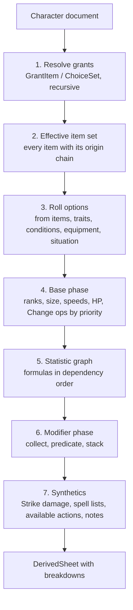

# Rules engine

`libs/rules/engine` turns a character plus loaded content into a sheet, and explains every number on it.
It is pure, synchronous and deterministic: no I/O, no clock, no randomness. Dice live in `libs/rules/dice`.

```ts
derive(input: {
  character: CharacterDocument;   // choices, inventory, play state, overrides
  content: ContentRegistry;       // every enabled pack, official and homebrew
  variants: VariantRuleSet;       // campaign or character variant rules
  situation?: Situation;          // known situational facts, e.g. at roll time
}): DerivedSheet
```

## Core vocabulary

| Concept      | Meaning                                                                                                               |
| ------------ | --------------------------------------------------------------------------------------------------------------------- |
| Statistic    | A named number with a base and modifiers: AC, Perception, Fortitude, Athletics, Strike attack, Speed                  |
| Selector     | The stable key of a statistic: `ac`, `perception`, `save:fortitude`, `skill:athletics`, `speed:land`                  |
| Domain       | A group a statistic belongs to, so one effect can hit many: `all`, `check`, `skill-check`, `dex-based`, `attack-roll` |
| Modifier     | A typed bonus or penalty aimed at selectors or domains, with an optional predicate and an origin                      |
| Rule element | A data instruction on a content entry: grant an item, add a modifier, set a value, offer a choice                     |
| Roll option  | A string fact about the current state, `self:condition:frightened`, `item:trait:agile`, `terrain:forest`              |
| Predicate    | A logic expression over roll options that gates a rule element or modifier                                            |
| Origin       | The chain that explains why something is on the character                                                             |
| Breakdown    | The explained result of a statistic: total, applied lines, suppressed lines, conditional lines, notes                 |

### Statistics are content

Statistic definitions are a content kind (`statistic`), not hard-coded. The core rules pack defines AC, saves,
Perception, the skills, class DC, spell attack and DC, Strikes, speeds, HP and so on. `StatisticDefinition` in
`libs/rules/sdk` (`statistic.ts`) gives each:

- its `selector` and `domains`,
- its `base` formula, written in a small safe expression language (`10 + @attr.dex.capped + @prof.ac`) and
  limited to actor references (`StatisticFormulaSource`), since a statistic has no item, plus the weapon's or
  spellcasting entry's when it is derived per source,
- its `kind`: `check` (rolled), `dc` (static) or `value` (neither, such as Hit Points or a Speed), and its
  `keyAttribute` when it has one,
- its `per`, when it is derived once per weapon or spellcasting entry rather than once ("Statistics per source").

A pack uses each selector once; a second statistic with the same selector is an issue at its `selector`. Two packs
may share one, and `ContentRegistry#statisticsFor(selector)` returns them in registration order; which applies is
the engine's choice.

The core rules pack is hand-authored in `content/packs/core-rules` (pack id `core-rules`), since Foundry defines
these statistics in code rather than as items. So far it holds:

| Statistic    | Selector                                                 | Kind    | Base                                              | Domains                                                      |
| ------------ | -------------------------------------------------------- | ------- | ------------------------------------------------- | ------------------------------------------------------------ |
| AC           | `ac`                                                     | `dc`    | `10 + @attr.dex.capped + @prof.ac`                | `dex-based`                                                  |
| Fortitude    | `save:fortitude`                                         | `check` | `@attr.con + @prof.save.fortitude`                | `check`, `saving-throw`, `con-based`                         |
| Reflex       | `save:reflex`                                            | `check` | `@attr.dex + @prof.save.reflex`                   | `check`, `saving-throw`, `dex-based`                         |
| Will         | `save:will`                                              | `check` | `@attr.wis + @prof.save.will`                     | `check`, `saving-throw`, `wis-based`                         |
| Perception   | `perception`                                             | `check` | `@attr.wis + @prof.perception`                    | `check`, `wis-based`                                         |
| Skills       | `skill:<slug>`                                           | `check` | `@attr.<key> + @prof.skill.<slug>`                | `check`, `skill-check`, `<key>-based`                        |
| Hit Points   | `hp:max`                                                 | `value` | `@ancestry.hp + (@class.hp + @attr.con) * @level` | `hp`                                                         |
| Speed        | `speed:land`                                             | `value` | `@ancestry.speed`                                 | `speed`, `all-speeds`, `land-speed`                          |
| Other Speeds | `speed:fly`, `speed:swim`, `speed:climb`, `speed:burrow` | `value` | `0`                                               | `speed`, `all-speeds`, `<type>-speed`                        |
| Reach        | `reach`                                                  | `value` | `5`                                               | `reach`                                                      |
| Dying limit  | `dying-max`                                              | `value` | `4`                                               | `dying`                                                      |
| Class DC     | `class-dc`                                               | `dc`    | `10 + @attr.key + @prof.class-dc`                 | `class`                                                      |
| Strike       | `strike:<weapon>`                                        | `check` | `@weapon.attr + @weapon.prof`                     | `check`, `attack-roll`, `strike-attack-roll`, `<attr>-based` |
| Spell attack | `spell-attack:<entry>`                                   | `check` | `@spellcasting.attr + @spellcasting.prof`         | `check`, `attack-roll`, `spell-attack-roll`, `<attr>-based`  |
| Spell DC     | `spell-dc:<entry>`                                       | `dc`    | `10 + @stat.spell-attack`                         | `spell-dc`, `<attr>-based`                                   |

Domains use one vocabulary, following Foundry's names so imported selectors keep their meaning:

- `all` reaches every statistic and is never listed.
- `check`: every rolled statistic (`kind: check`).
- `<attribute>-based` (`str-based` to `cha-based`): every statistic keyed to that attribute.
- `saving-throw`: the three saves.
- `skill-check`: the 16 skills and every Lore.
- `lore`: every Lore.
- `hp`: maximum Hit Points.
- `speed` and `all-speeds`: every Speed. `<type>-speed` (`land-speed`): one movement type, as in Foundry.
- `class`: the class DC, which has no `<attribute>-based` domain, since its key attribute is the character's choice.
- `attack-roll`: every attack roll, Strikes and spell attacks. `strike-attack-roll`: every Strike.
  `spell-attack-roll`: every spell attack. `spell-dc`: every spell DC.
- A statistic derived per source is also in the `<attribute>-based` domain of the attribute its source keys it to.

The skills are Acrobatics through Thievery, each keyed to its Player Core attribute (Arcana to Intelligence, Athletics
to Strength). Armor check penalties are not in the base: they are rule elements on armor.

The core pack also holds the proficiency bonus table `@prof` reads, one formula per rank over `@level` only (Player
Core: untrained `0`, trained `2 + @level` up to legendary `8 + @level`), and the variant rule
`proficiency-without-level` (GM Core): a `ProficiencyBonus` rule element whose table drops level and makes untrained
-2. A variant enabled for a character is put in play like any rule element, with a `variant` origin hop, and each base
term reading `@prof` names it ([ADR-0026](../adr/0026-proficiency-bonus-table-is-content.md)). `characterStatistics` and
`rollSetups` take the enabled variants in `StatisticSources.variants` and put them in play ahead of the character's items.

The fly, swim, climb and burrow Speeds start at 0: an ancestry gives none, so a `Change` that upgrades one
(`speed:fly`) raises it from nothing, and one that finds a Speed already higher leaves it. A Speed penalty from the
`all-speeds` domain reaches them too, so a total at or below 0 means the character cannot move that way; the sheet
lists a non-land Speed, with its breakdown, only above 0.

Hit Points, Speed and class DC read what the character's ancestry and class give: `@ancestry.hp`, `@ancestry.speed`,
`@class.hp`, and `@attr.key`, the modifier of the key attribute chosen for the class. `StatisticInputs` carries them
as `ancestry` (`hitPoints`, `speed`) and `class` (`hitPoints`, `keyAttribute`). Until an ancestry or class is
chosen, a statistic whose base reads one fails at the first such reference (`engine.statistic.noAncestry`,
`engine.statistic.noClass`), as a reference to a missing statistic does; the others still derive. The check runs on
the reference the evaluator reached, so one in a `ternary` branch not taken never fails. A rule element value that
reads them before they are chosen gets the formula language's general "has no value" error. Hit Points use
the character's level as written, so level 0 play (GM Core) needs its own formula.

### Statistics per source

A statistic with `per: weapon` or `per: spellcasting` is derived once for each weapon or spellcasting entry the
character has (ADR-0030). `StatisticInputs` carries them: `weapons` (slug, category, traits, range, potency, origin)
and `spellcasting` (slug, tradition, attribute), slugs unique within each list. The definition's selector names the
family; each instance is `<selector>:<slug>` (`strike:longsword`, `spell-dc:arcane`), so modifiers, overrides and
`@stat` reach it as any statistic. With no weapons or entries a family has no instances, and removing one removes
its statistics.
The entries are the `SpellcastingEntry` elements in play (`spellcastingInPlay`), one per slug, in slug order.

- An instance takes its key attribute from its source and joins that attribute's `<attribute>-based` domain. A
  family names no `keyAttribute`.
- The base may read the source: `@weapon.attr` (Dexterity for a ranged weapon, the higher of Strength and Dexterity
  for a finesse one, else Strength, as Player Core's "Attack Rolls" has it), `@weapon.prof` (the bonus for
  `attack:<category>`), `@spellcasting.attr` and `@spellcasting.prof` (the bonus for `spellcasting`, the character's
  one spellcasting rank, whatever the entry's tradition; ADR-0040).
- A weapon's potency (its potency rune, or a bomb's own item bonus) is not a base term. The engine adds it to the
  weapon's `strike:<slug>` as a synthetic `item` modifier with the slug `weapon-potency`, labelled by a message and
  with the weapon's origin, so it stacks with other item bonuses to attack rolls (a mutagen's): only the highest
  applies, and the breakdown shows the potency line suppressed when another wins. Automatic Bonus
  Progression (GM Core) needs no formula change either: it removes potency runes, so weapons carry no `potency` and
  get no line, and its variant pack adds its own `potency`-typed `FlatModifier` to attack rolls. The slug lets an
  `AdjustModifier` find the line for anything that changes a rune's bonus.
- Worn armour's bonus (its own and its potency rune's) is not a base term either. The engine adds it to `ac` as a
  synthetic `item` modifier with the slug `armor-bonus`, named by the armour and with its origin (an `inventory`
  hop), so it stacks with other item bonuses to AC (bracers of armour): only the highest applies. Armour with no
  bonus adds no line. The armour's Dexterity cap is the `dexterityCap` input `@attr.dex.capped` reads. Its
  resilient rune's grade is a second synthetic `item` modifier, slug `resilient`, on the `saving-throw` domain, so
  every save gets it and it stacks the same way. The character domain passes potency and resilient only while the
  armour is invested.
- Inside an instance, `@stat.<family>` naming another family derived per the same kind of source reads that
  family's instance for the same source: the spell DC's `@stat.spell-attack` reads its own entry's spell attack
  base, so a bonus to spell attack rolls stays off the DC.
- A later definition of a selector replaces an earlier one before instances are made. Where an instance and a plain
  statistic share a selector (`strike:longsword`), the one given later wins.
- A family's selector is at most 63 characters and a source's slug at most 64, so every instance's selector is a
  selector (128 at most). A longer one is a validation issue at the selector or the slug.

Known limits: a thrown melee weapon gets its melee Strike only; Strike damage is the weapon's dice and type plus the
flat bonus below, with no damage dice or alterations from rule elements yet (`DamageDice`, `DamageAlteration`), and
no critical specialisation.

### Strike damage and the multiple attack penalty

A Strike is the pair of statistics `strike:<weapon>` (the attack roll) and `strike-damage:<weapon>` (the flat damage
it adds), plus what the engine reads off the weapon itself. `deriveStrikes` (step 7) joins them, per weapon, into a
`Strike` the sheet shows: its attack, its damage and its multiple attack penalty.

- **Flat damage.** `strike-damage` has `@weapon.damage` as its base: Strength for a melee or thrown weapon (a `thrown`
  or `thrown-<range>` trait), half of a positive Strength, rounded down, or all of a negative one, for a propulsive
  ranged weapon, and none for any other ranged weapon (Player Core, "Damage Rolls"). Its domains are `damage` and
  `strike-damage`, and like every per-weapon family it joins its key attribute's `<attribute>-based` domain, so a bonus
  to damage rolls reaches it as it does any statistic, with the breakdown the attack roll has.
- **Dice.** A weapon's `damage` (dice, die, type) before runes. A striking rune adds its grade to the dice of a weapon
  that rolls a die; flat damage (a blowgun's 1 piercing) has none to add to, and a weapon with no dice and no die
  does no damage (a glue bomb). A bomb's persistent damage and splash (`damage.persistent`, `splash`) ride on the
  Strike's damage, unchanged by the flat bonus or a striking rune. The Strike also carries the weapon's range
  increment and, for a `consumable` weapon, the stack it throws from (`quantity`), so a stack of bombs is one Strike
  and the sheet shows how many are left. Throwing and spending the stack belong to the play loop.
- **Multiple attack penalty.** -5 on a second attack and -10 on a third, or -4 and -8 with an `agile` weapon. It is
  a pair of numbers on the Strike, not a statistic: a `MultipleAttackPenalty` rule element (already in the SDK)
  reaches it when the play loop lands, since the penalty applies per turn rather than per Strike.
- **Strikes a feature gives.** `Strike` has two shapes: `fist: true`, and an attack of its own with a `slug`,
  `category`, `damage` and optionally `group`, `traits` and `range`, which the engine treats as a held weapon with the
  element's origin (`display.label` names it on the sheet). The Foundry importer reads `damage.base` as `damage`.

Lore is open-ended, so the core pack defines none. Whatever grants a Lore (a background, a feat) brings its own
`statistic` entry with the selector `skill:lore:<topic>`, base `@attr.int + @prof.skill.lore.<topic>`, key
attribute Intelligence and domains `check`, `skill-check`, `int-based` and `lore`. Two packs granting the same Lore
share its selector, which `statisticsFor` already allows. The Foundry importer adds a background's Lore statistics
to `core-rules` as vocabulary (content-model.md, "Foundry import"). A selector's words are joined by `:`; `-` only
joins the words of one name (`skill:lore:pathfinder-society`).

Homebrew can add statistics (a "Sanity" check, a new skill, a new speed). Variant rules from GM Core are packs
that change formulas or add slots: Proficiency Without Level overrides the proficiency formula, Automatic Bonus
Progression adds potency modifiers and removes rune requirements, Free Archetype adds feat slots. If the engine can
express those three as data, it can express most homebrew; they are acceptance tests for the design.

Formulas are parsed into an AST at import or authoring time and evaluated by an interpreter. No `eval`, no
JavaScript in content.

### Formula language

`libs/rules/formula` parses formula text into a tree. It depends only on the kernel, so `rules/sdk` can check
the formulas in rule elements with it, and the engine evaluates statistic formulas with it. The parser takes any
`FormulaText`, so it can report empty or overlong text; `FormulaSource` in `rules/sdk` is the stored, bounded form,
passed in as `FormulaText.parse(source)`.

```text
formula    = sum
sum        = product (("+" | "-") product)*
product    = unary (("*" | "/") unary)*
unary      = "-" unary | primary
primary    = number | reference | call | "(" sum ")"
number     = digits                                  (whole, 0 to 999999)
reference  = "@" segment ("." segment)*              (@level, @attr.dex.capped)
segment    = [A-Za-z0-9_-]+
call       = function "(" (sum ("," sum)*)? ")"
function   = min | max | floor | ceil | abs | round | sign
           | ternary | eq | ne | gt | gte | lt | lte
```

- The functions are Foundry's `Math` subset and the comparison helpers pf2e adds to `Math`. `min` and `max`
  take one or more arguments, `ternary` three, the comparisons two and the rest one. Any other name is an error.
- Hyphens belong to the reference, as in Foundry's data paths: `@level-1` is one reference, so write `@level - 1`
  to subtract.
- Every node keeps its 1-based position. Errors are message descriptors with a position, and the parse
  outcome has the same shape as the dice parser's.
- `references(formula)` lists every reference with its position. The statistic graph uses it for dependency
  edges.
- `printFormula` prints canonical text with single spaces around operators and only the parentheses the
  tree needs. Parsing that text gives the same tree back.
- Limits: 500 characters, 32 levels of nesting (groups, call arguments
  and negations) and 200 nodes.
- Which reference paths exist and what they mean belongs to the reference vocabulary ("Formula references"
  below). The parser only checks their syntax.

#### Evaluation and rounding

`evaluate(formula, resolve)` is pure: `resolve` gives each reference's value (a safe integer) or reports it
unknown, and the outcome is `{ ok: true, value }` or `{ ok: false, error, position }`, the error a message
descriptor pointing at the node that failed.

The semantics follow Foundry's. pf2e's `RuleElementPF2e#resolveValue` pastes the reference values into the text
(its own `#replaceFormulaData`) and runs it through `Roll.safeEval`, which evaluates it as JavaScript with `Math`
and pf2e's helpers in scope and does not round. `FlatModifier` reads the result with `Number(value) || 0` and
clamps it to its `min` and `max`. So:

- Arithmetic is JavaScript's double arithmetic, in the tree's order. Division keeps fractions: `@level / 2 * 2`
  is `@level`, and `floor`, `ceil` and `round` see the fraction. `round` is `Math.round`, which rounds halves
  up (`round(-2.5)` is -2).
- The language rounds once: the final value is rounded **down** (`Math.floor`), so `@level / 2` at level 5 is
  2 and `-5 / 2` is -3. Foundry would keep 2.5 (ADR-0014). Rounding down is the PF2e default (Player Core,
  "Rounding"), and where a fraction matters Foundry content wraps the division in `floor`, so both agree.
- Comparisons (`eq`, `ne`, `gt`, `gte`, `lt`, `lte`) give 1 or 0, as pf2e's `true` and `false` do in
  arithmetic. `ternary` treats any value but 0 as true and evaluates only the branch it takes.

Where Pioneer deliberately differs from Foundry:

- Pioneer evaluates every formula. pf2e only evaluates text with a reference in it: `1 + 2` stays a string,
  which `FlatModifier` reads as 0.
- A comparison result is 1 or 0 everywhere. pf2e's helpers return booleans and compare strictly, so
  `eq(gte(@level, 5), 1)` is `true === 1`, false, in Foundry and 1 in Pioneer.
- pf2e evaluates both branches of a `ternary`. That only matters when the branch not taken fails.
- A negated negative reference works: pf2e turns `-@x` with `@x = -2` into `--2`, a syntax error, and falls back
  to the rule element's default. Pioneer gives 2.
- Failures Foundry does not have, each pointing at the failing node: an unknown reference (Foundry warns and uses
  the default), division by zero (JavaScript gives `Infinity` or `NaN`), and any value, intermediate ones
  included, outside the safe integer range (where doubles stop holding every whole number). As far as we know,
  Foundry core's `Roll.safeEval` also rejects a result that is not a finite number (a top-level `Infinity` or a
  bare boolean) and falls back to the default. Its source is not public, so this is unverified.

The property tests check the evaluator against a model of Foundry's evaluation: the tree printed as JavaScript,
run with pf2e's `Math` helpers, and rounded down. The model brackets reference values and reads comparisons as
1 or 0, as listed above, and records zero divisors and unsafe values so that every failure the evaluator reports
is one Foundry's JavaScript met too.

#### Formula references

Statistic base formulas and rule element values share one vocabulary of references (ADR-0016), catalogued in
`libs/rules/sdk` (`formula-reference.ts`). Stored formulas use these paths only:

| Reference            | Scope        | Value                                                                                       |
| -------------------- | ------------ | ------------------------------------------------------------------------------------------- |
| `@level`             | actor        | The character's level                                                                       |
| `@attr.<attribute>`  | actor        | The attribute modifier, `@attr.str` to `@attr.cha`                                          |
| `@attr.dex.capped`   | actor        | The Dexterity modifier after the armor's Dexterity cap (`DexterityCap`)                     |
| `@attr.key`          | actor        | The modifier of the key attribute chosen for the character's class                          |
| `@ancestry.hp`       | actor        | The Hit Points the character's ancestry gives                                               |
| `@ancestry.speed`    | actor        | The land Speed the character's ancestry gives                                               |
| `@class.hp`          | actor        | The Hit Points the character's class gives each level, before Constitution                  |
| `@prof.<selector>`   | actor        | The proficiency bonus for a statistic: its rank's formula in the proficiency bonus table    |
| `@rank.<selector>`   | actor        | The proficiency rank for a statistic, 0 (untrained) to 4 (legendary)                        |
| `@stat.<selector>`   | actor        | Another statistic's base, before its modifiers, such as the spell attack in a spell DC      |
| `@item.level`        | item         | The level of the item the rule element is on                                                |
| `@item.value`        | item         | The value of the condition the rule element is on: 2 on Frightened 2                        |
| `@weapon.attr`       | weapon       | The modifier the weapon attacks with: Strength, Dexterity at range, the higher with finesse |
| `@weapon.prof`       | weapon       | The proficiency bonus for the weapon's category, `attack:<category>`                        |
| `@spellcasting.attr` | spellcasting | The modifier for the spellcasting entry's attribute                                         |
| `@spellcasting.prof` | spellcasting | The proficiency bonus for spellcasting, `spellcasting`, one rank for every entry            |

- A selector's colons are written as dots, since references have none: `@prof.save.fortitude` is the bonus for
  `save:fortitude`, `@rank.attack.martial` the rank for `attack:martial`.
- Scope says whose value a reference reads. A rule element may sit on any content entry, so its formulas may use
  actor and item references. Statistic base formulas have no item, so they may use actor references, plus weapon or
  spellcasting references when the statistic is derived per that source (`StatisticDefinition` checks the scope
  against `per`). A spell's damage formulas may also read spellcasting references, the entry casting the spell
  (ADR-0051).
- `FormulaSource` checks a formula when content is validated: it must parse, and every reference must be in the
  catalogue and in scope. A `<selector>` is checked for shape only. Each problem is a field issue at the
  formula's JSON path. Its descriptor includes `position`, the 1-based position in the formula. A Foundry spelling
  gets an error naming the path to write instead.
- The fields checked are `FlatModifier.value`, `DexterityCap.value`, `AdjustModifier.value`, `Change.value`,
  `MultipleAttackPenalty.value`, a numeric `ItemAlteration.value` and `MartialProficiency.value`. The last takes a
  rank name or, as in Foundry, a formula giving a rank. The engine resolves it as pf2e does: a result of 0 or no
  value becomes 1 (trained), and anything else is clamped to 1 to 4. Foundry also allows a bare number, which the
  importer turns into the rank name.

The catalogue also holds the Foundry spellings the importer translates (`FOUNDRY_REFERENCES`, with
`fromFoundryPath`). Placeholders carry across by name:

| Foundry                                                                       | Pioneer                    |
| ----------------------------------------------------------------------------- | -------------------------- |
| `@actor.level`, `@actor.system.details.level.value`                           | `@level`                   |
| `@actor.abilities.<attribute>.mod`, `@actor.system.abilities.<attribute>.mod` | `@attr.<attribute>`        |
| `@actor.system.attributes.ancestryhp`, `@actor.ancestry.system.hp`            | `@ancestry.hp`             |
| `@actor.ancestry.system.speed`                                                | `@ancestry.speed`          |
| `@actor.system.movement.speeds.land.value`                                    | `@stat.speed.land`         |
| `@actor.system.attributes.classhp`, `@actor.class.system.hp`                  | `@class.hp`                |
| `@actor.skills.<skill>.rank`, `@actor.system.skills.<skill>.rank`             | `@rank.skill.<skill>`      |
| `@actor.saves.<save>.rank`, `@actor.system.saves.<save>.rank`                 | `@rank.save.<save>`        |
| `@actor.perception.rank`, `@actor.system.perception.rank`                     | `@rank.perception`         |
| `@actor.system.proficiencies.attacks.<category>.rank`                         | `@rank.attack.<category>`  |
| `@actor.system.proficiencies.defenses.<category>.rank`                        | `@rank.defense.<category>` |
| `@actor.system.proficiencies.spellcasting.rank`                               | `@rank.spellcasting`       |
| `@item.level`, `@item.system.level.value`                                     | `@item.level`              |
| `@item.badge.value`, `@item.system.value.value`                               | `@item.value`              |

The importer reports any other Foundry path as untranslatable. The exporter writes the first spelling listed. Paths
join the catalogue when the engine can supply their values. Formulas inside Foundry's bracketed values and
`{item|...}` injections are left to the Epic 2.6 translators.

## Modifiers and stacking

`libs/rules/engine` (`breakdown.ts`) defines these types. Roll notes join the breakdown with their own story.

```ts
interface Modifier {
  // `<entry>#<rule>`: the rule element that made it, stable across derivations; `weapon:<slug>#weapon-potency` for
  // the line the engine adds for a weapon's potency, `<armour entry>#armor-bonus` for worn armour's bonus
  id: RuleId;
  slug: RuleSlug | undefined; // lets an AdjustModifier find it
  // display.label, else its entry's name; a message for a line the engine adds itself
  label: { text: ContentText } | { entry: ContentId } | { message: MessageDescriptor };
  type: 'untyped' | 'status' | 'circumstance' | 'item' | 'proficiency' | 'attribute' | 'potency';
  targets: readonly ModifierTarget[]; // selectors or domains
  predicate: Predicate | undefined;
  origin: Origin;
}
```

PF2e stacking: within each typed category only the highest bonus and the lowest penalty apply; untyped bonuses
and penalties all apply; attribute and proficiency are single values set by the base formula. The engine applies
this and keeps the losers. Only applied lines compete, but a typed conditional line is checked against them: when
the applied winner of its type and direction is at least as large, it could never change the total, and `beatenBy`
names that winner. Untyped conditional lines are never beaten, and neither is a line when an adjustment waiting on
the situation could change it or its winner (one naming either's slug, or no slug).

```ts
interface BreakdownLine {
  modifier: Modifier;
  value: FormulaValue | undefined; // after adjustments; undefined only when failed
  adjustedBy: readonly RuleId[]; // the AdjustModifiers that changed it, in order
  status:
    | { kind: 'applied' }
    | { kind: 'suppressed'; by: RuleId; reason: 'stacking' | 'adjustment' } // lower status bonus; AdjustModifier suppress
    | {
        kind: 'conditional';
        when: Predicate;
        summary: PredicateSummary | undefined;
        beatenBy: RuleId | undefined; // an applied line of its type and direction at least as large
      } // depends on unknown situation
    | { kind: 'inactive'; reason: 'predicate' } // predicate known false
    | { kind: 'failed'; error: MessageDescriptor; position: TextPosition }; // a formula failed to evaluate
}

interface StatisticValue {
  selector: Selector;
  base: BaseTerm[]; // each formula term
  formulaValue: FormulaValue; // what the terms add up to
  baseValue: FormulaValue; // after the base phase's Changes; what modifiers add to and @stat reads
  lines: BreakdownLine[];
  computed: FormulaValue; // baseValue plus the applied lines
  total: FormulaValue; // computed, or the value a set override pinned it to
  overrides: OverrideLine[]; // Changes in the order they ran, then set overrides
  pinnedBy: RuleId | undefined; // the set override that pinned the total
}

interface OverrideLine {
  id: RuleId;
  label: ModifierLabel;
  origin: Origin; // who or what did it; a set override's has an override hop
  phase: 'base' | 'total';
  mode: 'add' | 'multiply' | 'upgrade' | 'downgrade' | 'override';
  value: RuleNumber | undefined;
  replaced: FormulaValue; // the value before this line
  result: FormulaValue; // the value after it
  status: applied | { replaced; by } | conditional | inactive | failed;
}
```

`deriveStatistics(definitions, inputs, { rules, facts })` runs the base phase (below, with its `Change`s), then for
each statistic:

1. **Collect.** A `FlatModifier` in play becomes a modifier. It reaches a statistic when one of its targets is the
   statistic's selector, one of its `domains`, or `all`.
2. **Value.** A number is used as written. A formula is evaluated with the character's inputs, `@stat.<selector>`
   (another statistic's base), `@item.level` (the level of the item the element is on) and `@item.value` (the value
   the condition it is on arrived with, as grants report it: Clumsy 1 from Encumbered). A failure makes the line
   `failed`; it never throws. `@item.value` has no value on an element of anything but a valued condition; effect
   badges join with effects in play (#349).
3. **Adjust.** Each `AdjustModifier` that reaches the statistic and whose predicate is known to hold runs, in
   priority order (Foundry's default 100) and then id order, on the modifiers with its `slug` (all of them when it
   has none). `add`, `subtract`, `multiply`, `upgrade` (at least), `downgrade` (at most) and `override` change the
   value, rounded down; `suppress` removes the line, naming the adjustment. An adjustment whose predicate depends on
   the situation does not run yet.
4. **Gate.** The predicate, in Kleene logic against the derivation's roll options: true applies, false is inactive,
   unknown is conditional, with a `PredicateSummary` (or the element's `display.summary`).
5. **Stack.** Among applied, typed lines, each type's highest bonus and lowest penalty apply and the rest are
   suppressed by the winner. A tie goes to the smaller id, so the result does not depend on the order of the rules.
   A typed conditional line no larger than its type and direction's winner stays conditional with `beatenBy` naming
   the winner, ties included, unless a situational adjustment could change either.
   The computed total is the base plus the applied lines; a set override may then pin it ("Overrides"). Property
   tests check order independence, that the computed total is the base plus the applied lines, that untyped modifiers
   always sum, that adding a typed bonus no higher than one already applied never raises the total, and that a set
   override always wins while the computed value is still reported.

That is the AC stack the sheet shows: base 10, Dexterity capped by the armour, proficiency from the class, the
armour's item bonus, a shield's bonus (inactive until a Raise a Shield effect is on the character), _frightened 1_
(status penalty, applied, from the condition, caused by a Demoralize logged in the campaign), a lower status bonus
suppressed by a higher one, and any manual override with who set it.

Damage uses the same machinery with extra line kinds: damage dice, damage type changes, critical specialisation,
and immunity, weakness and resistance adjustments.

## Rule elements

Rule elements are the only way content changes a character. The vocabulary follows Foundry pf2e's semantics,
because that is the dataset we import and the system we export to (see
[ADR-0008](../adr/0008-rule-element-vocabulary.md)). Our schema is typed; theirs targets raw data paths.

| Group       | Rule elements                                                                                                                                                                                                                                                                                                                                                                                                                                                          |
| ----------- | ---------------------------------------------------------------------------------------------------------------------------------------------------------------------------------------------------------------------------------------------------------------------------------------------------------------------------------------------------------------------------------------------------------------------------------------------------------------------- |
| Structure   | `GrantItem`, `ChoiceSet`, `RollOption` (incl. toggles), `ItemAlteration`                                                                                                                                                                                                                                                                                                                                                                                               |
| Numbers     | `FlatModifier`, `AdjustModifier`, `Change` (add, upgrade, downgrade, override, multiply), `DexterityCap`, `MultipleAttackPenalty`                                                                                                                                                                                                                                                                                                                                      |
| Proficiency | `Proficiency` (raise a rank), `MartialProficiency`, `ProficiencyBonus` (replace the bonus table)                                                                                                                                                                                                                                                                                                                                                                       |
| Magic       | `SpellcastingEntry` (a spellcasting entry: tradition, attribute, preparation), `SpellSlots` (slots or cantrips for an entry), `PoolSpells` (the spells a pool takes), `DeitySpells` (the deity's spells join an entry's list), `SignatureSpells` (signature spells for a spontaneous entry), `FocusSpells` (a focus entry's focus spells), `InnateSpells` (the spells an innate entry casts), `RepertoireSpells` (spells a spontaneous entry must know, one slot each) |
| Checks      | `RollTwice`, `SubstituteRoll`, `AdjustDegreeOfSuccess`, `RollNote`                                                                                                                                                                                                                                                                                                                                                                                                     |
| Strikes     | `Strike`, `AdjustStrike`, `DamageDice`, `DamageAlteration`, `CriticalSpecialization`                                                                                                                                                                                                                                                                                                                                                                                   |
| Defences    | `Immunity`, `Weakness`, `Resistance`, `TempHitPoints`, `FastHealing`                                                                                                                                                                                                                                                                                                                                                                                                   |
| Creature    | `BaseSpeed`, `Sense`, `CreatureSize`, `BattleForm`, `Language`, `ActorTraits`, `SpecialResource`, `SpecialStatistic`, `Aura`                                                                                                                                                                                                                                                                                                                                           |
| Actions     | `GrantAction` (an action becomes available, with its own predicate)                                                                                                                                                                                                                                                                                                                                                                                                    |

Each element is a discriminated union member with its own zod schema in `libs/rules/sdk`. Every element has an
optional `predicate`, a `priority`, and an optional `display` hint. Unknown keys are a validation error; the
importer reports Foundry elements it cannot translate rather than dropping them silently.

The Structure, Numbers and Proficiency groups are in the SDK. `Proficiency` raises one statistic's rank on its
selector, weapon and armour categories included (`attack:martial`), standing in for Foundry's rank
`ActiveEffectLike` upgrades. `ProficiencyBonus` is Pioneer's own: it replaces the proficiency bonus table,
as a variant rule does (ADR-0026). `MartialProficiency` keeps Foundry's schema and defaults: a new proficiency for the
weapons or armour a predicate defines, whose rank can follow a category's (`sameAs`) up to `maxRank`. From the
Defences group, `Immunity`, `Weakness` and `Resistance` are in the SDK too (see "Defences" below), and from the
Creature group `Sense` (see "Senses" below) and `Language`: it grants languages and opens slots to pick them in, each
offering languages no rarer than its `access`, standing in for Foundry's `subfeatures.languages` and its
`ActiveEffectLike` on `system.build.languages.max` (ADR-0043). `ActorTraits` adds traits to the character or removes
them, each setting `self:trait:<trait>` over its ancestry's (ADR-0048). From the Strikes group, `Strike` is in the SDK
in two shapes: a fist, an unarmed weapon of the `fist` base (ADR-0048), and an attack of its own (see "Strike
damage"). A deity's favoured weapons read
`attack:favored-weapon`, a `Proficiency` selector standing in for Foundry's `favoredWeaponRank`: a Strike with one uses
the better of it and its category's rank. The Checks and Actions groups, the rest of Strikes, Defences and Creature,
land with their Epic 2.6 translator stories, so each schema arrives with the Foundry content that exercises it.

`SpellcastingEntry` is Pioneer's own too ([ADR-0040](../adr/0040-spellcasting-entries-are-rule-elements.md)): Foundry
has no element for an entry, which its player adds by hand. While its predicate holds it gives the character an entry
(`slug`, `tradition`, `attribute`, and `preparation`: prepared, spontaneous, innate or focus), and makes them trained in
`spellcasting`, the one rank every entry reads; a `Proficiency` raises it further. Two in play with one slug are one
entry, the first in play.

`SpellSlots` is Pioneer's own as well ([ADR-0041](../adr/0041-spell-slots-are-rule-elements.md)): it adds `value`
slots of a `rank`, cantrips, or slots at the entry's `highest` rank below 10th to the entry named `entry`, either to its
own slots or to a `pool` kept apart (a divine font, a curriculum). Counts add up per entry, pool and rank, so a class's
table is a few elements gated by level; one for an entry not in play adds nothing. `PoolSpells` names the `spells` a
`pool` of an entry takes ([ADR-0045](../adr/0045-pool-spells-are-rule-elements.md)), adding up per pool and gated by
its predicate, so a divine font's spell follows the font picked. `DeitySpells` names an `entry` the character's deity's
spells join ([ADR-0048](../adr/0048-a-clerics-deity-grants-through-rule-elements.md)): its own slots offer each at the
rank the deity grants it or higher, whatever its tradition. `SignatureSpells` gives the spontaneous `entry` it names
signature spells ([ADR-0047](../adr/0047-signature-spells-are-rule-elements.md)); a prepared or innate one never has
them. `FocusSpells` gives the focus `entry` it names its focus `spells` ([ADR-0050](../adr/0050-focus-spells-are-rule-elements.md)),
adding up per entry and gated by its predicate, so a domain's spell follows the domain picked; the focus pool is worked
out from them, never stated. `InnateSpells` gives the innate `entry` it names spells it casts, each at a rank
([ADR-0067](../adr/0067-innate-spells-are-a-rule-element.md)): a feat's once-a-day spell. They take no slot.
`RepertoireSpells` gives the spontaneous `entry` it names spells it must know, each at a
rank ([ADR-0062](../adr/0062-repertoire-spells-are-a-rule-element.md)): a sorcerer's bloodline gifts, an oracle's
granted spells; each fills the first free repertoire slot of its rank. `spellcastingInPlay` gives each entry its slots
and pools, each pool with its spells, whether a `DeitySpells` names it, whether it has signature spells, its focus
spells and its repertoire spells.

## Derivation pipeline



1. **Grants.** Starting from the character's direct choices (ancestry, heritage, background, class, feats, items,
   conditions, effects), resolve `GrantItem` and `ChoiceSet` recursively. Class features at each level, feats that
   grant actions or spells, conditions that imply other conditions (_grabbed_ grants _off-guard_). Cycles are an
   error. Unresolved choices become open slots for the builder.
2. **Effective set.** The flat list of every item in play, each with its origin chain.
3. **Roll options.** Facts derived from the set and the play state. Situational facts come from `situation`.
4. **Base phase.** `Change` operations in priority order (Foundry's ordering: add, multiply, upgrade, downgrade,
   override), proficiency rank upgrades (highest wins, all contributors listed).
5. **Statistic graph.** Statistics form a DAG through their formulas (AC depends on Dexterity, which depends on
   boosts). Evaluated in topological order, memoised, cycles reported with the offending formula. Strike attack
   rolls, spell attacks and spell DCs are statistics here, one per weapon or spellcasting entry.
6. **Modifiers.** Collected per selector through domains, predicates evaluated, stacking applied.
7. **Synthetics.** Strikes (`deriveStrikes`: attack, damage and multiple attack penalty), spell lists, the
   available action list, roll notes.

### Grant resolution

Steps 1 and 2 live in `libs/rules/grants` (`resolveGrants`), beside the engine rather than in it: it depends only on
`rules/sdk`, `rules/predicate` and the kernel, and the engine composes it. It reads content through a lookup
(`ContentId` to kind, name, rule elements, sources and the entry's own roll options, and every entry of a kind), so
any kind of entry can grant any other.

- Roots are the character's direct entries, each with the hop that put it there (a `choice` slot, a `condition`, an
  `effect`). They are visited in entry id order, so the result does not depend on the order they are given in.
- **Root slots** are the slots the character has itself (`ancestry`; heritage, background and class to come), each
  a key and a content kind. One offers every entry of its kind, sorted by name. A pick that is an entry of that kind
  answers it and becomes a root behind a `choice` hop; a pick of anything else is an error and the slot is open. They
  read no facts, so they are read once, before the rounds. `grantLookup` reads the content registry as grants do
  (ancestries for now), so the server resolves a character's slots over loaded content. Nothing grants a root slot,
  so it has no origin: its key names it. Root slots are reported apart (`rootSlots`), not in `open` or `answered`.
- A fixed `GrantItem` adds its entry with a `grant` hop naming the granter and the rule index. Each item's origin is
  the hops from the character down to it, with the item itself as `entry`.
- A grant of an entry already on the character is skipped and reported as a duplicate, unless `allowDuplicate`.
- A grant back to an entry above it on the chain is a cycle, reported once with every entry on it and not followed.
  A missing entry is an error at its grant, and a chain longer than an origin records (64 hops) stops there. The
  other grants still resolve.
- A grant's predicate is evaluated like a modifier's. True follows the grant, false drops it, and unknown reports it
  as a **conditional grant** with its predicate summary: not on the character, and not followed further.
- An inline `ChoiceSet` whose predicate is true is a **slot**, keyed `<entry id>:<rule index>`. The entry is on the
  character once, so the key is stable however it got there, and picks (slot key to value) survive re-resolution.
  Options whose predicate is false are left out; unknown ones are offered with their summary.
- A pick among the offered options answers the slot, and its `rollOption` sets `<rollOption>:<pick>`. A pick that is an
  entry sets its slug less its kind (`feat:order-explorer:leaf-order`), as Foundry names an item pick. A
  `GrantItem { choice: <flag> }` on the same entry grants the picked entry behind a `choice` hop, then a `grant` hop.
  With no pick the slot is **open** and the grant waits; a pick not on offer is an error and the slot reopens. A pick
  that is a plain option, not an entry, cannot be granted. Removing a pick drops everything granted through it.
- A `ChoiceSet` whose `choices` is a query (`{ kind, filter }`) offers every entry of that kind whose filter is not
  false, as one slot like any other. The filter reads the character's facts, with the candidate's own roll options
  under `item:` (`item:trait:fighter`, `item:level:1`, as Foundry writes them). They replace whatever the character
  has under `item:`, and never mix with its `feat:` or `self:` facts. Unknown candidates are offered with their
  summary. Offers sort by name, then id, so a builder list is stable. A query that matches nothing is an open slot
  with an empty offer, not an error. A query may also set `ownTrait` (`class` or `ancestry`): the candidate must carry
  a trait named like one of the character's `class:` or `ancestry:` facts, so Natural Ambition offers "a 1st-level
  class feat for your class" and Ancestral Paragon "a 1st-level ancestry feat". Foundry reads the actor's trait inside
  the filter (`item:trait:{actor|system.details.class.trait}`), which a roll option cannot spell. With two classes
  (Dual Class) either counts; with none picked the offer is empty. A feat candidate reads a little more than its
  envelope says, as the rules do (`candidate-options.ts`): a skill feat also has `general` ("any general feat
  (including skill feats)", Player Core), a Universal Ancestry feat has the trait of the character's ancestry (Fey
  Influence), and a feat an archetype lists under Additional Feats has `archetype` and the archetype's level for a
  character holding its dedication (Shield Warden for Knight Vigilant). A `ChoiceSet` that lists only feats is a
  feat slot too (Voice of Nature).
- A slot's offer is worked out the first time it is read, against the facts its walk read, and kept. The slots
  returned come from the settled round, so those are the resolution's `facts`. No round needs the offer: an open slot
  grants nothing, and an answered slot tests only its pick (looked up by id, of the query's kind, filter not false;
  or a listed option whose predicate is not false). So resolution costs the same however much content is installed,
  and a query over every candidate runs only when a builder shows the slot.

#### Facts from the set, to a fixpoint

Grant and choice predicates read facts the set itself provides, so resolution runs in rounds. Each round walks the
grants as above against the facts of the round before, then derives the facts again from the set it reached:

- the level, as `self:level:<level>` (an input; a negative level sets none);
- each entry's kind option, as Foundry writes it: `class:fighter`, `feature:<slug>` for a class or ancestry feature,
  `feat:<slug>`, `ancestry:`, `heritage:`, `background:`, `self:condition:<slug>`, `self:effect:<slug>`. Creatures
  and statistics set none;
- a valued condition's value, as `self:condition:<slug>:<value>` beside `self:condition:<slug>` (_frightened 2_ sets
  `self:condition:frightened:2`), so `{ "gte": ["self:condition:frightened", 2] }` reads it. The value comes from
  the root's `condition` hop. A valued condition granted by another entry arrives at the `GrantItem`'s `value`, else
  1 (Foundry's badge default): _encumbered_ grants _clumsy 1_; a condition that carries no value (_off-guard_, from
  _grabbed_) sets its slug alone. A condition that arrives twice keeps its highest value alone, since a comparison
  holds if any value does, and the second arrival is a duplicate as usual;
- each `RollOption` element in the `all` domain whose predicate holds: a static one unless its `value` is false, and
  a toggle while it is on. A toggle's state comes from input keyed `<entry id>:<rule index>`, else its `value`; while
  on it also sets `<option>:<suboption>` for the picked suboption if offered, else the first offered. Options in
  other domains only reach rolls in them, so grants never read them;
- each answered slot's `<rollOption>:<pick>`, with every namespace a `ChoiceSet` on the set writes to made known;
- each of the character's traits, as `self:trait:<trait>`: its ancestry's, and those `ActorTraits` elements whose
  predicate holds add, less those any of them removes (ADR-0048).

The supplied situation (`terrain:forest`) is added on top. Facts are rebuilt from scratch every round, so an entry
whose predicate stops holding drops out with what it set. Once a round's set derives the facts it read, it has
settled: the result is that round's items, slots, conditional grants and toggles, its derived `rollOptions`, and
its `facts` for step 3.

A round that derives facts an earlier round read never settles: a grant negated by what it grants (or a roll
option that undoes itself). Only the entries every round in the loop has are kept, with the options they all
agree on, and an error names the entries that come and go or set what comes and goes. Rounds are capped at 32; past
that the last two rounds are compared the same way. Resolution always ends.

The golden Level 1 Fighter (`testing/fighter.ts`) resolves to its class, Shield Block, Reactive Strike, the skill
choice and a class feat slot; at 20th level with every slot picked it settles in a few rounds well inside its 3 ms
bench budget. The same budget holds with an ancestry adding ancestry, general and skill feat slots (about 30 query
slots in all, every one picked) over a thousand more feats.

### Statistic graph

The base phase in `libs/rules/engine` (`StatisticBases`) is step 5. The inputs are the character's
level, attribute modifiers, proficiency rank per selector (a selector left out is untrained), the armor's Dexterity
cap, what the ancestry and class give, and the weapons and spellcasting entries statistics are derived per. The ranks
come from the effective set: `ranksInPlay` reads the `Proficiency` elements in play whose predicate holds, and each
`SpellcastingEntry` as trained in `spellcasting`, and keeps the highest raise per selector, so a class's starting rank
and a feature's later raise compete. The spellcasting entries come from it too (`spellcastingInPlay`). It keeps only
the rank for now; the contributors step 4 lists join when a breakdown shows where a rank came from. The other inputs
are supplied directly until their epics produce them.

- Statistics derived per source are expanded into their instances first ("Statistics per source").
- Edges come from `references(formula)`. `@prof.<selector>` and `@rank.<selector>` read that selector's rank, an
  input, so they add no edge between statistics. `@stat.<selector>` reads another statistic's base and is the
  edge.
- A later definition of a selector replaces an earlier one, as a pack registered later (homebrew after core)
  restates a statistic.
- Evaluation follows Tarjan's strongly connected components, which come out dependencies first, so each statistic
  is evaluated once and the work is linear in statistics plus references. Statistics are visited in selector order,
  so the result does not depend on the order of the definitions.
- A component of several statistics, or one that reads itself, is a cycle. Each statistic in it fails at its
  first reference into the cycle, and the error names every statistic in it. A reference to a missing statistic,
  or to one that failed, is an error at that reference. A formula that fails to evaluate fails as the formula
  evaluator reports. None of these throws, and the other statistics still evaluate.
- Each top-level term of the base formula becomes a `BaseTerm` with its printed text, sign, value and position:
  `10`, `@attr.dex.capped`, `@prof.ac`. A bracketed sum stays one term. Each term is evaluated and rounded down on
  its own; if the terms then miss the formula's value (`@level / 2 + @level / 2` at an odd level), a rounding line
  makes up the difference, so the lines always add up to the base.

`@stat.<selector>` reads the other statistic's base, not its total. Modifiers reach each statistic through its own
selector and domains, so a bonus to spell attack rolls does not leak into a spell DC built on the spell attack, and
modifiers never depend on other modifiers.

Performance target: full derivation of a level 20 character in under 10 ms in the browser, so the builder can
re-derive on every keystroke. Incremental recomputation is an optimisation for later, not a design constraint.

`libs/rules/catalog/src/full-derivation.bench.ts` holds the whole budget. It resolves a level 20 Fighter's
grants to a fixpoint, then derives every core statistic with the grants' facts. The load has four Strikes, armor and
shield, item bonuses that stack by type, a suppressed status bonus, a conditional line and an inactive one. A second
case adds Proficiency Without Level and a homebrew pack that restates Perception. Grant resolution keeps its own
3 ms budget (`libs/rules/grants`); statistics get the rest. Measured locally: about 0.2 ms for grants and 0.8 ms for
statistics.

### Defences

Defences are synthetics (step 7). `Immunity`, `Weakness` and `Resistance` rule elements keep Foundry's fields:
`type`, a formula `value` for weaknesses and resistances, `exceptions` (`resistance 5 physical except adamantine`)
and `predicate`. The engine turns them into the character's immunities, weaknesses and resistances, each with its
origin chain:

- A predicate that is true applies the defence, false drops it, and unknown makes it **conditional**, as a
  conditional modifier is ("Predicates and conditional modifiers").
- Weaknesses and resistances do not stack. Per type or group, the highest unconditional value counts, and the
  others are listed under it as superseded. A conditional one is kept beside it, since it may beat it when it
  applies.
- A target is one damage type or a group (`physical`, `energy`, `all`), and group membership is
  `DAMAGE_GROUP_TYPES` in the SDK, never content.
- The unconditional defences, with conditional ones whose toggles are on, form a `DamageTarget`, so the damage
  pipeline in `libs/rules/dice` takes the character's defences as it takes any creature's.
- Exceptions travel with the defence: `DamageAdjustment` gains an optional `exceptions` list of damage traits
  (materials such as adamantine or cold iron, `magical`). The engine never filters on them, since it does not know
  the damage; `libs/rules/dice` checks them per instance when it picks the highest weakness or resistance, and
  skips one whose exception the instance has. `DamageInstance` carries no traits yet, so until Strike damage
  records them (Epic 4.6) an exception is shown on the sheet but never matches, and the defence applies in full.

`deriveDefences` in `libs/rules/engine` does this, beside `deriveStatistics` and over the same inputs; `type` is a
list, as in Foundry, and each type or group it names becomes its own line. A value formula reads the character's
inputs and the level of the item the element is on, not other statistics, as a `Change`'s does, so defences never
wait on the statistic graph. A value of 0 or less comes to nothing (`@item.level - 4` on a low-level item) and the
line is left out; a formula that fails, or a value past `DamageAmount`'s bound, makes the line failed. Ties for the
highest go to the lowest rule id, so the result never depends on the order of the rules. A failed line that was
conditional keeps its predicate. `damageTargetOf` turns the result into a `DamageTarget` (in `rules/sdk`, beside
`CreatureDefinition`), taking the applied and superseded lines and the conditional ones whose rule ids are toggled
on. Superseded is for the sheet only: the pipeline still gets those lines, because it picks the highest per damage
instance and must fall back to a lower one when the instance has the higher one's exception.

Not read yet, so the schemas reject them rather than apply a defence wrongly:

- Weaknesses and resistances to a material (`weakness 5 cold-iron`), which are not damage types or groups; they
  arrive with damage traits on `DamageInstance`.
- `exceptions` on `Immunity`: `DamageTarget`'s immunities are bare slugs with no room for them.
- Foundry's `mode` on `Immunity` (removing one), `doubleVs` on `Resistance`, and `override` on weaknesses and
  resistances. The Epic 2.6 translator reports content that uses them as untranslated.

### Senses

A `Sense` element names a `sense` entry of the `core-rules` vocabulary (darkvision, scent, tremorsense) by id, with
Foundry's optional `acuity` and `range` in feet. `sensesInPlay` in `libs/rules/engine` collects the character's senses
from the ancestry's `vision` (precise, unlimited) and the `Sense` elements whose predicate holds; one that depends on
the situation gives none on the sheet. As in Foundry, a sense with no acuity is precise and one with no range is
unlimited. Of the grants of one sense, one that another grant beats on acuity or range, without being worse on the
other, is dropped; grants that read alike are one sense with every origin. Where one grant is best on both, it alone
remains. Where neither beats the other (imprecise scent 30 feet, vague scent with no range), both remain, as the rules
read: imprecise within 30 feet, vague beyond. Foundry instead keeps whichever grant is better on either, which can
lose the better acuity. The result is in order of sense id, then the more acute and the farther first.

The engine reads an element's acuity and range as written. A sense whose definition fixes them (`SenseData`:
darkvision is precise and unlimited) should not give them; the importer leaves them off, as Foundry ignores them.
Foundry's `force` (a sense replacing a better one) is not read, so the importer keeps such elements in the backlog.

### Vitals and size

`vitalsInPlay` in `libs/rules/engine` reads the `FastHealing`, `TempHP` and `CreatureSize` elements whose predicate
holds; one that depends on the situation gives nothing on the sheet. Values are numbers or formulas over the
character, and one below 1, or a formula with no value, is ignored. Recovery and temporary Hit Points do not add up
(Player Core): of fast healing, of regeneration and of temporary Hit Points the highest counts, with every element that
gives it as an origin. `CreatureSize` applies in the order found: a named size sets the size, a number of steps moves it
(never below tiny, never past its `maximumSize` when growing). The reach is the size's, unless the last element that
names one overrides it or adds to it. The result is read-only on the sheet: the play state still holds the temporary
Hit Points a player enters, and no recovery is applied for them.

### Battle forms

A `BattleForm` element holds what a polymorph spell or feature sets while it lasts: `form` has the base statistics
(Armor Class, skills, speeds, senses, size, Strikes, temporary Hit Points, immunities, weaknesses and resistances, form
traits) and the flags `canCast`, `canSpeak`, `hasHands` and `keepsOwnUnarmed`. Each of `brackets` changes the form from
its `start` spell rank, so a heightened form is data. A value is a number or a formula over the character
(`18 + @level`). Records in Foundry (skills, senses, Strikes) are lists here, and a Strike's `slug` names it. A weakness
or resistance may name a damage trait (`water`, `holy`) as well as a damage type; the engine decides what it matches.
The importer reads the element in full; one that depends on a pick (Dragon Form's damage type and speeds), a formula
over `@item`, or a Strike without a damage type stays in the backlog.
The engine applies the replaced statistics, Strikes, temporary Hit Points, defences, traits and restrictions.

#### Replaced statistics

`battleFormInPlay` picks the form in force: a `BattleForm` element whose predicate holds, the one with the smallest
rule id if several do. Effects with the `polymorph` trait are exclusive first (`exclusiveEffects`): the newest wins, so
only its rules reach this pick. The form is heightened first (`heightened`): the brackets that start at or below the
spell rank of the item the element sits on (`@item.level`) are laid over it, lowest first. A bracket replaces a size,
temporary Hit Points or form traits, merges speeds and Armor Class fields, and merges lists by name (skill, sense,
Strike slug, damage type), a Strike's damage field by field. Without a rank the base form stands. The form stage
runs after the modifier phase and any set override, which keeps a pin:

- **Armor Class** is the form's `armorClass.modifier` plus the lines that still apply. The form removes every positive
  item bonus (armour's among them); status, circumstance and untyped lines and item penalties stay. Armour's check
  penalty on skills goes too unless the form says `ignoreCheckPenalty: false` (every Player Core battle form ignores
  it and the Speed reduction, so that is the default); a removed line is `Suppressed` with the reason `form`, and the
  form is the rule that removed it. The form's value stands only if it beats the character's own total ("use your
  own if higher"); otherwise nothing changes.
- **Skills** the form lists are set the same way, with `ownIfHigher: false` setting them outright.
- **Speeds**: when the form lists speeds, each `speed:<movement>` is set to the form's value (0 for one it does not
  list), whether or not that is higher. Status and circumstance lines still apply.
- **Senses**: a form that lists senses replaces all of the character's (`sensesInPlay`); one that lists none leaves
  them.
- **Size** (`vitalsInPlay`): a form that names a size sets it before `CreatureSize` elements apply, and the reach is
  that size's.

A replaced statistic carries a `form` (`FormReplacement`): which rule, the form's base and total, the character's own
total, whether the form's or the character's own stands (`source`), and a message-keyed `summary` ("22 from Plant Form
(arboreal); yours 19"). Its `computed` and `total` are the form's base plus the applied lines when the form stands.
A form value with no value (a formula over a missing class) fails the statistic.

#### Strikes and temporary Hit Points

`deriveStrikes` asks `strikesUnderForm` (`battle-form-strikes.ts`) which weapons and statistics the Strikes come from
while a form is in force; it needs the rule elements in play (`StrikeRulesInput`), and without a form nothing changes.

- **Weapon Strikes are suppressed.** The form's `strikes` replace them. The character's own unarmed Strikes (weapons of
  category `unarmed`, the fist) stay only when the form sets `keepsOwnUnarmed`. A form Strike whose predicate does not
  hold is left out.
- **Attack**: the form Strike's `modifier` is its whole attack modifier, a number or a formula over the character. The
  higher of it and the character's best own unarmed attack stands, and the Strike's attack carries a `form`
  (`FormReplacement`) saying which. A character with no unarmed Strike has nothing to compare, so the form's stands.
- **Damage**: the form's dice, die and type, with its flat `damage.modifier` as the Strike's damage bonus (the
  character's Strength does not add). `DamageDice`, `DamageAlteration` and `Note` elements reach a form Strike as they
  do a weapon's. A form Strike has no damage line unless it names dice and a type.
- A form Strike is a `WeaponInputs` of category `unarmed` unless it names one, with the form as its origin.
- **Temporary Hit Points** (`vitalsInPlay`): `tempHP` joins the `TempHP` elements, so the highest of them counts and
  the form is an origin of the amount when it gives it. It is derived, so it goes when the form does.

#### Defences, traits and restrictions

- **Defences** (`deriveDefences`): the form's `immunities`, `weaknesses` and `resistances` join those of the `Immunity`,
  `Weakness` and `Resistance` elements, with the form as origin (`battle-form-defences.ts`). They are applied, since
  the form's predicate holds, and a value may be a formula over the character. The highest per type or group counts, so
  a form's resistance 5 supersedes the character's own 3 to the same type. A weakness or resistance that names a trait
  (`holy`) rather than a damage type or group is left out: the damage pipeline matches only types and groups.
- **Traits** (`factsUnderForm`): the form's `traits` become the character's roll options (`self:trait:plant`) while it
  lasts. The character's equipped facts carry them, so every predicate reads them. A form's own predicate should
  not depend on the traits it grants: it is tested again on the facts that carry them.
- **Restrictions** (`availableActions`, `battle-form-actions.ts`): an action is unavailable, with a reason that names
  the form (`engine.action.formCantCast`, `formCantSpeak`, `formNoHands`), when the form sets `canCast: false` and the
  action casts a spell (Cast a Spell, or a spell), `canSpeak: false` and it has the `auditory` or `linguistic` trait,
  or `hasHands: false` and it has the `manipulate` trait. A flag the form leaves out forbids nothing. An action needing
  several things the form lacks gives a reason for each.

### Strike dice and notes

`deriveStrikes` takes the rule elements in play (`StrikeRulesInput`) and `strikeRules` reads the `DamageDice`,
`DamageAlteration` and `Note` elements whose predicate holds and whose selectors reach a Strike's rolls: for damage
`strike-damage:<slug>`, `strike-damage`, `<slug>-damage` and `damage`, for the attack `strike:<slug>`, `strike`,
`<slug>-attack`, `attack`, `attack-roll` and `strike-attack-roll`. An element that depends on the situation (the target
is undead) gives nothing here. Elements apply in the order found:

- A `DamageDice` with a `dieSize` adds `ExtraDice` of its own (one die by default), typed `damageType` or as the weapon,
  in its `category` and for a critical hit only when `critical`. Without a `dieSize` it adds `diceNumber` to the
  weapon's dice, or overrides their type.
- A `DamageAlteration` changes the weapon's dice number by its `mode` (never below 0) or overrides its type.
- A weapon with no die rolls flat damage, which neither changes.
- A `Note` comes back on each of the Strike's rolls it reaches, with its `outcome` and origin.

The extra dice and notes are shown beside the Strike's damage; the dice are not yet rolled with it.

### Item alterations

`alterItem` in `libs/rules/engine` changes an item's content with the `ItemAlteration` elements whose predicate holds and
whose `items` predicate holds for the item's own roll options (`item:type:shield`, `item:trait:agile`,
`item:slug:steel-shield`, `item:equipped`). `alteredItem` in `libs/character/domain` builds those options and the item's
numbers from its content. An element that depends on the situation gives nothing here. Elements apply in the order
found:

- A numeric property (`ac-bonus`, `check-penalty`, `dex-cap`, `hardness`, `hp-max`, `range-increment`,
  `speed-penalty`, `strength`) changes by its `mode`, never below 0. An item with no value for the property (armour
  with no Dexterity cap, a melee weapon's range increment) takes one from `upgrade`, `downgrade` and `override` only.
- `traits`, `materials` and `property-runes` add or remove one value; `damage-type` overrides the weapon's.
- A value that is a formula reads no references, as the item is read before the character's numbers are known. One that
  needs them has no value and changes nothing.

Only equipped items are altered, and only when armour, a weapon or a shield is equipped, as reading the rules in play
resolves the character's grants. The sheet reads the result where it already shows the item: armour's bonus, Dexterity
cap, check penalty and Strength through the AC and skill breakdowns, a shield's Hardness, Hit Points and Broken
Threshold beside the Strikes, and a weapon's traits, range increment and damage type on its Strike. A weapon's
materials and the property runes an element adds are listed on its Strike. A property rune etched on the item works
through its own rules, not through this list. `speed-penalty` is altered but nothing reads armour's speed penalty yet.

## Predicates and conditional modifiers

Predicates use Foundry's JSON shape so imported content needs no rewriting: an array means _all_, plus `or`, `and`,
`not`, `nor`, `gte`, `lte` and friends over roll options.

The difference is evaluation. Foundry evaluates at roll time with full context. We also evaluate on the static
sheet, where the situation is unknown, so predicates use **three-valued (Kleene) logic**:

- Roll option namespaces are classified. `self:*`, `item:*`, `class:*`, `feat:*` are _known_: present means true,
  absent means false. Namespaces such as `action:*`, `terrain:*`, `target:*`, `check:*` and `situation:*` are
  _situational_: absent means **unknown**, not false.
- `and`, `or` and `not` follow Kleene logic, so `["action:seek", "terrain:forest"]` is unknown on the sheet.
- A modifier whose predicate is **true** applies, **false** is inactive, **unknown** becomes a **conditional
  line**. The UI renders it as "+1 circumstance to Seek when in forest (Favored Terrain)" next to the statistic,
  unless an applied line of its type and direction already beats it (`beatenBy`); then only the breakdown lists it.
- At roll time the roll dialog lists the conditional lines for that statistic as toggles, pre-filled from the
  known situation (in an encounter, using Stealth for initiative). Choosing them supplies facts, re-evaluates, and
  the roll records which were used.
  - `deriveStatistics` takes a `situation` input, the rule ids a roll has chosen. A modifier or adjustment in it whose
    predicate is unknown counts as holding; one whose predicate is false stays inactive.
  - `rollSituation(statistic)` reports what a roll can choose: the conditional lines that could change the total
    (one an applied line already beats is left out) and the roll options its lines read (`predicateOptions` in
    `libs/rules/predicate`).
  - `rollSetup` in `libs/character/domain` joins them for a character: given a `RollRequest` (selector plus chosen
    rule ids) it returns the offered lines, the `RollOption` toggles the lines read, and the statistic as chosen. The
    total always equals the base plus the applied lines, whatever the toggles.
  - `rollSetups` does the same for many statistics at once, each with its own chosen rules, from the sheet's own
    derivation, so a statistic with nothing claimed costs no derivation. The sheet claims situations per statistic and
    derives only the claimed ones again. A Strike's attack is one of those statistics (`strike:<slug>`), so its claims
    reach `rollSetups` the same way.

### Evaluation

`libs/rules/predicate` evaluates predicates. It depends only on `rules/sdk` and the kernel, so grants and statistics
share it.

```ts
const facts = new PredicateFacts(rollOptions, namespaces); // once per derivation; indexes numeric suffixes
evaluatePredicate(predicate, facts); // 'true' | 'false' | 'unknown'
tracePredicate(predicate, facts); // the same, with every nested statement's verdict, for explaining
```

The namespace is a roll option's first word. The table is content: the core rules pack lists it under
`rollOptionNamespaces` (`content/packs/core-rules/pack.json`), checked against the roll options in Foundry's feats,
class and ancestry features, conditions, effects and equipment:

| Kind        | Namespaces                                                                                                                                                                                                                               |
| ----------- | ---------------------------------------------------------------------------------------------------------------------------------------------------------------------------------------------------------------------------------------- |
| Known       | `self`, `item`, `parent`, `class`, `feat`, `feature`, `ancestry`, `heritage`, `background`, `deity`, `armor`, `skill`, `defense`                                                                                                         |
| Situational | `self:action`, `self:flanking`, `self:participant`, `action`, `attack`, `bonus`, `check`, `damage`, `encounter`, `inflicts`, `lighting`, `origin`, `penalty`, `proficiency`, `situation`, `spellcasting`, `target`, `terrain`, any other |

The longest listed namespace an option starts with decides, so `self:participant:initiative:rank` is situational
while `self:effect:rage` is known. `item` and `parent` are known because the engine always evaluates them against a
specific item. A namespace missing from the table is situational, so a gap shows up as a conditional line instead of
hiding a modifier. The namespaces a `ChoiceSet` writes its pick to (`kinetic-gate:air`) are the character's own
facts: grant resolution adds them as known with `withKnown`.

Any pack may add namespaces (a homebrew `sanity`), and `ContentRegistry.rollOptionNamespaces()` merges every
registered pack's into the table `PredicateFacts` reads, so a new namespace needs no code change. Two packs may list
the same namespace with the same kind; a pack that gives one the other kind is rejected when it registers, with the
issue at that entry. `rules/predicate` keeps only the table type and the lookup (`kindOf`, `withKnown`).
Tests below the content packs use a copy, `CORE_NAMESPACES` in `@pioneer/rules/sdk/testing`, which the core
rules pack's tests check against the pack.

Statements follow Foundry's `Predicate.test`, lifted to three values:

- A plain option is true when present. Missing, it is false in a known namespace and unknown otherwise.
- `and`, `or` and `not` are Kleene's. `nand` and `nor` are their negations, and `if`/`then` is `not if or then`.
  `xor` is true when exactly one is true and nothing is unknown, false once two are true. `iff` is false once one
  is true and another false, and unknown while any is unknown.
- `{ "eq": [a, b] }` with two options compares their text, as Foundry does, so it never depends on the facts. With a
  number, it looks for `a:b`. Missing, that is false once `a` is in a known namespace or has some other value, and
  unknown before.
- `gt`, `gte`, `lt` and `lte` read every number after `a:` (`self:level:5` gives 5) and hold when some value of `a`
  beats every value of `b`. An operand with no value makes the test false if its namespace is known, and unknown if
  it is situational. Once an option has a value, it is settled: further values of the same option are not expected.

Summaries for conditional lines are generated from the predicate with a per-locale vocabulary table
(`terrain:forest` reads "in forest"), with an optional authored `summary` for anything the generator renders badly.

```ts
summarisePredicate(predicate, facts, element.display?.summary); // PredicateSummary | undefined
formatSummary(summary, { message, list }); // text in the viewer's locale
```

`summarisePredicate` returns a tree only while the predicate is unknown. It keeps the unknown parts and drops the
parts known to hold: `["self:effect:rage", "terrain:forest"]` while raging summarises as "you are in forest".
Phrases are bare conditions, and negation is pushed down to them (each message has a `negated` select: "you are not
in darkness"), so no "unless" has to reach over a list. `and` and `or` become locale lists, and a list inside another
is introduced with "either" or "both" so its scope reads clearly. `if`/`then` reads as "not the condition, or the
consequence", and `xor` and `iff` reduce to what is left to decide. The UI wraps the result: "It holds when
…".

The vocabulary is a prefix table in `libs/rules/predicate` (`action`, `terrain`, `lighting`, `target:trait`,
`target:condition`, `target:mark`, `self:participant:initiative:stat`). Each prefix has one message whose ICU `select`
maps the rest of the option to words, with the slug as the fallback, so translators extend the vocabulary in message
files. Select keys use `_` for `-`, which ICU does not allow. Other options read "`option` applies", and comparisons
name the option and the value. An authored `display.summary` on the rule element replaces the whole generated summary.

## Messages, not strings

The engine never produces display text. Labels, suppression reasons, conditional summaries, unavailability reasons
and validation errors are message descriptors (`{ key: 'breakdown.suppressed.stacking', params: { by } }`) or
content text references (`{ entry, field: 'name' }`). The UI formats them in the viewer's locale with ICU
MessageFormat. Tests assert on keys and params. See [ADR-0009](../adr/0009-i18n-and-lazy-loading.md).

## Provenance

```ts
type OriginHop =
  | { kind: 'choice'; slot: SlotKey } // the player picked it
  | { kind: 'grant'; by: ContentId; rule: number } // granted by another item's rule element
  | {
      kind: 'inventory';
      item: InventoryItemId;
      state: 'worn' | 'held' | 'invested';
    }
  | {
      kind: 'condition';
      condition: ContentId;
      value?: number;
      appliedBy?: EventRef;
    }
  | { kind: 'effect'; effect: ContentId; appliedBy?: EventRef }
  | { kind: 'override'; by: UserId; at: Instant; note?: string }
  | { kind: 'variant'; rule: ContentId };

interface Origin {
  hops: readonly OriginHop[]; // outermost first: Fighter -> Shield Block feature -> Shield Block action
  entry: ContentId; // the content entry holding the rule element
  sources: readonly SourceRef[]; // that entry's book/page/AoN references
}
```

Every breakdown line, granted item, available action and open choice slot carries an origin, except a root slot,
which nothing grants and its key names. "Why is my AC 18?"
and "where did this action come from?" are the same query.

## Overrides

Overrides are rule elements with an `override` origin hop, injected from the character document. They never
replace derived data in storage. Two modes:

- **Adjust:** an extra modifier ("GM blessing, +1 status to AC"), a `FlatModifier` with an override origin. Goes
  through normal stacking.
- **Set:** pin a statistic to a value, a `Change` with mode `override` and an override origin. It acts on the total
  after modifiers, not the base, so other statistics' `@stat` references still read the computed base. Of several,
  the last by priority and then id wins; the others are listed as replaced by it. The breakdown keeps the computed
  value (`computed`), the pinned value (`total`), and `pinnedBy`, whose origin says who pinned it, when and why. Set
  overrides are visually flagged everywhere the statistic appears.

Every other `Change` runs in the base phase, on the value the base formula gives, in Foundry's mode order (add,
multiply, upgrade, downgrade, override), then priority, then id. Each is an `OverrideLine` with the value it
replaced; a change whose predicate does not hold or depends on the situation, or whose formula fails, leaves the
value as it was. A change's formula reads the inputs and the level of the item it is on, not `@stat`, so changes
add no edges to the statistic graph.

Custom effects (ad hoc homebrew attached to one character) are the same thing with more than one rule element.

## Testing strategy

- Property tests: stacking invariants (order independence, adding a lower typed bonus never raises the total,
  untyped always sums, a beaten conditional line never changes the total once its situation holds, untyped
  conditional lines are never beaten), Kleene laws for predicates, formula evaluator against a reference.
- Golden tests: Paizo pregens (Foundry's `paizo-pregens` and `iconics` packs) derived and compared against
  their published statistics.
- Each rule element type has fixture tests with hand-written content in `libs/rules/engine/testing`.
